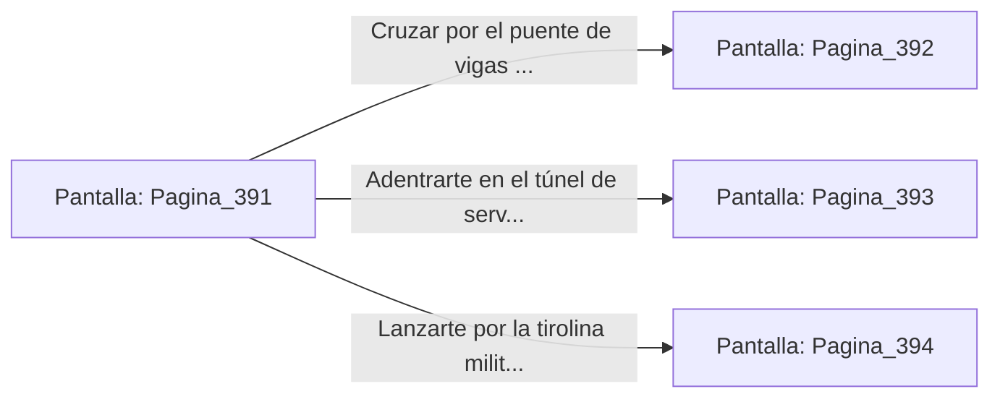

# 📺 Nodo Pantalla: `Pagina_391`

[[Index|⬅️ Índice]] | Fichero Origen: [[sample_eligejuego-code_capitulo_21_mpl|📄 sample/eligejuego-code/capitulo_21.mpl]]

**Narrativa y Encabezado:**
> PÁGINA 391: LA ENTRADA AL GRAN ABISMO
> 
> Al cruzar el umbral del Santuario Final, la calzada de mármol da paso a una serie de plataformas suspendidas sobre el Gran Abismo de Aethelgard. Una niebla de éter violeta asciende desde la profundidad insondable, mientras relámpagos de energía temporal cruzan el espacio en intervalos regulares.
> 
> Tu Brazal de Convergencia registra que las vibraciones de las Cámaras 391 a 410 forman el primer anillo defensivo del Núcleo Profundo. Los restos de la antigua Legión del Abismo patronan las pasarelas metálicas, equipados con visores térmicos y lanzas de arco electromagnético.
> 
> Ante ti se abren tres itinerarios para continuar la travesía: un puente de vigas flotantes que cruza el abismo, un túnel de servicio excavado en la pared de basáltica y una tirolina militar de alta velocidad.

## 📋 Desglose de Instrucciones de Opciones
### `OPCION "Cruzar por el puente de vigas flotantes sobre el abismo" CON_ACCION TRANSICIONAR_A Pagina_392`
* **Instrucción:** `OPCION` *(Manual: Mapea una entrada o botón interactivo de usuario. Vincular una acción como la invocación de una función C1, un método C2 o una transición C3.)*
* **Efecto de Control:** Dispara `TRANSICIONAR_A` hacia [[Pantalla_Pagina_392|📺 Pagina_392]]
### `OPCION "Adentrarte en el túnel de servicio excavado en la roca" CON_ACCION TRANSICIONAR_A Pagina_393`
* **Instrucción:** `OPCION` *(Manual: Mapea una entrada o botón interactivo de usuario. Vincular una acción como la invocación de una función C1, un método C2 o una transición C3.)*
* **Efecto de Control:** Dispara `TRANSICIONAR_A` hacia [[Pantalla_Pagina_393|📺 Pagina_393]]
### `OPCION "Lanzarte por la tirolina militar de alta velocidad" CON_ACCION TRANSICIONAR_A Pagina_394`
* **Instrucción:** `OPCION` *(Manual: Mapea una entrada o botón interactivo de usuario. Vincular una acción como la invocación de una función C1, un método C2 o una transición C3.)*
* **Efecto de Control:** Dispara `TRANSICIONAR_A` hacia [[Pantalla_Pagina_394|📺 Pagina_394]]

## 📊 Diagrama de Flujo e Interacción (Mermaid)

