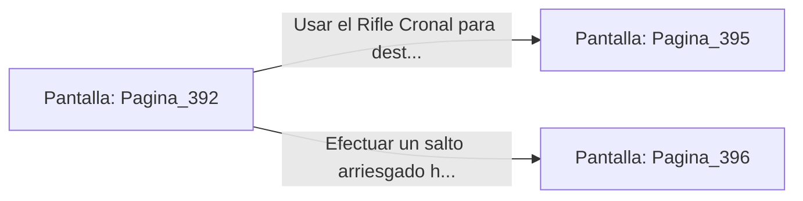

# 📺 Nodo Pantalla: `Pagina_392`

[[Index|⬅️ Índice]] | Fichero Origen: [[sample_eligejuego-code_capitulo_21_mpl|📄 sample/eligejuego-code/capitulo_21.mpl]]

**Narrativa y Encabezado:**
> PÁGINA 392: EL PUENTE DE VIGAS FLOTANTES
> 
> Avanzas con cautela saltando de viga en viga. El viento helado del abismo intenta desestabilizarte a cada paso, mientras la niebla violeta reduce la visibilidad a apenas unos metros de distancia.
> 
> A mitad del trayecto, una patrulla de dos centinelas abisales detecta tus pisadas y despliega sus escudos electromagnéticos bloqueando el acceso a la plataforma fija.

## 📋 Desglose de Instrucciones de Opciones
### `OPCION "Usar el Rifle Cronal para destruir los escudos de los centinelas" CON_ACCION TRANSICIONAR_A Pagina_395`
* **Instrucción:** `OPCION` *(Manual: Mapea una entrada o botón interactivo de usuario. Vincular una acción como la invocación de una función C1, un método C2 o una transición C3.)*
* **Efecto de Control:** Dispara `TRANSICIONAR_A` hacia [[Pantalla_Pagina_395|📺 Pagina_395]]
### `OPCION "Efectuar un salto arriesgado hacia la cornisa inferior" CON_ACCION TRANSICIONAR_A Pagina_396`
* **Instrucción:** `OPCION` *(Manual: Mapea una entrada o botón interactivo de usuario. Vincular una acción como la invocación de una función C1, un método C2 o una transición C3.)*
* **Efecto de Control:** Dispara `TRANSICIONAR_A` hacia [[Pantalla_Pagina_396|📺 Pagina_396]]

## 📊 Diagrama de Flujo e Interacción (Mermaid)

