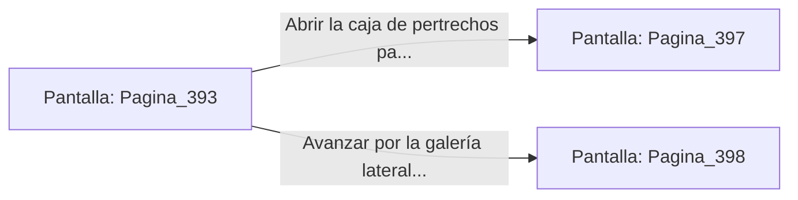

# 📺 Nodo Pantalla: `Pagina_393`

[[Index|⬅️ Índice]] | Fichero Origen: [[sample_eligejuego-code_capitulo_21_mpl|📄 sample/eligejuego-code/capitulo_21.mpl]]

**Narrativa y Encabezado:**
> PÁGINA 393: EL TÚNEL DE BASALTO
> 
> Te adentras en el angosto túnel de piedra basáltica. El aire aquí es denso y seco, saturado por el olor a ozono que emana de los conductos energéticos que recorren la pared como gruesas venas luminosas.
> 
> Tras diez minutos de marcha en ascenso, el túnel desemboca en un cruce de caminos iluminado por un depósito de cristal de éter. Junto a la pared descubres una caja de pertrechos militares olvidada por la antigua guardia.
> 
> Tienes la oportunidad de abrir la caja para conseguir células de energía de alto flujo o continuar por la galería lateral hacia las Bóvedas de la Legión.

## 📋 Desglose de Instrucciones de Opciones
### `OPCION "Abrir la caja de pertrechos para recuperar células de energía" CON_ACCION TRANSICIONAR_A Pagina_397`
* **Instrucción:** `OPCION` *(Manual: Mapea una entrada o botón interactivo de usuario. Vincular una acción como la invocación de una función C1, un método C2 o una transición C3.)*
* **Efecto de Control:** Dispara `TRANSICIONAR_A` hacia [[Pantalla_Pagina_397|📺 Pagina_397]]
### `OPCION "Avanzar por la galería lateral hacia las Bóvedas de la Legión" CON_ACCION TRANSICIONAR_A Pagina_398`
* **Instrucción:** `OPCION` *(Manual: Mapea una entrada o botón interactivo de usuario. Vincular una acción como la invocación de una función C1, un método C2 o una transición C3.)*
* **Efecto de Control:** Dispara `TRANSICIONAR_A` hacia [[Pantalla_Pagina_398|📺 Pagina_398]]

## 📊 Diagrama de Flujo e Interacción (Mermaid)

