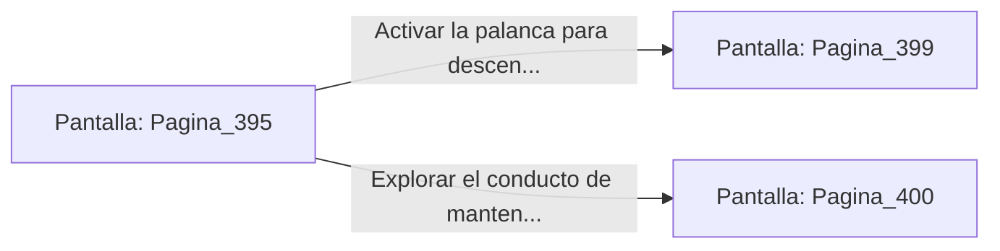

# 📺 Nodo Pantalla: `Pagina_395`

[[Index|⬅️ Índice]] | Fichero Origen: [[sample_eligejuego-code_capitulo_21_mpl|📄 sample/eligejuego-code/capitulo_21.mpl]]

**Narrativa y Encabezado:**
> PÁGINA 395: DISPARO EN LAS VIGAS
> 
> Alineas la mira de tu Rifle Cronal y descargas dos ráfagas de aceleración. Los proyectiles atraviesan el punto ciego de los escudos electromagnéticos, sobrecargando los núcleos de los dos centinelas y haciéndolos despeñarse al abismo.
> 
> Con la vía libre, alcanzas la plataforma fija del otro lado, donde un panel de control rúnico permite activar el ascensor de carga hacia el segundo nivel del abismo.
> 
> Cargas las baterías de tu Brazal en el conector del panel antes de activar la palanca de descenso.

## 📋 Desglose de Instrucciones de Opciones
### `OPCION "Activar la palanca para descender en el ascensor de carga" CON_ACCION TRANSICIONAR_A Pagina_399`
* **Instrucción:** `OPCION` *(Manual: Mapea una entrada o botón interactivo de usuario. Vincular una acción como la invocación de una función C1, un método C2 o una transición C3.)*
* **Efecto de Control:** Dispara `TRANSICIONAR_A` hacia [[Pantalla_Pagina_399|📺 Pagina_399]]
### `OPCION "Explorar el conducto de mantenimiento adyacente al panel" CON_ACCION TRANSICIONAR_A Pagina_400`
* **Instrucción:** `OPCION` *(Manual: Mapea una entrada o botón interactivo de usuario. Vincular una acción como la invocación de una función C1, un método C2 o una transición C3.)*
* **Efecto de Control:** Dispara `TRANSICIONAR_A` hacia [[Pantalla_Pagina_400|📺 Pagina_400]]

## 📊 Diagrama de Flujo e Interacción (Mermaid)

