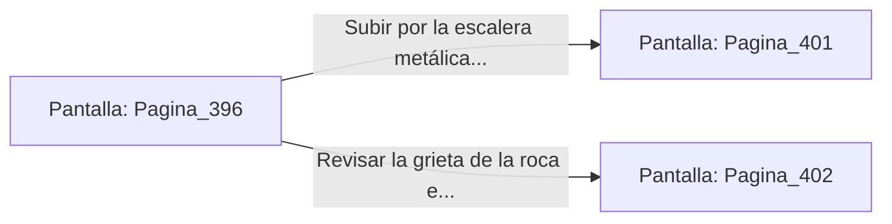

# 📺 Nodo Pantalla: `Pagina_396`

[[Index|⬅️ Índice]] | Fichero Origen: [[sample_eligejuego-code_capitulo_21_mpl|📄 sample/eligejuego-code/capitulo_21.mpl]]

**Narrativa y Encabezado:**
> PÁGINA 396: EL SALTO A LA CORNISA INFERIOR
> 
> Te te lanzas al vacío rodando limpiamente sobre la cornisa de piedra inferior. Esquivas a los centinelas, pero el impacto de la caída sobrecarga temporalmente tus amortiguadores térmicos.
> 
> Avanzas a paso lento por la estrecha cornisa hasta encontrar una escalera metálica que asciende a los depósitos.

## 📋 Desglose de Instrucciones de Opciones
### `OPCION "Subir por la escalera metálica hacia los depósitos de la Legión" CON_ACCION TRANSICIONAR_A Pagina_401`
* **Instrucción:** `OPCION` *(Manual: Mapea una entrada o botón interactivo de usuario. Vincular una acción como la invocación de una función C1, un método C2 o una transición C3.)*
* **Efecto de Control:** Dispara `TRANSICIONAR_A` hacia [[Pantalla_Pagina_401|📺 Pagina_401]]
### `OPCION "Revisar la grieta de la roca en busca de un atajo" CON_ACCION TRANSICIONAR_A Pagina_402`
* **Instrucción:** `OPCION` *(Manual: Mapea una entrada o botón interactivo de usuario. Vincular una acción como la invocación de una función C1, un método C2 o una transición C3.)*
* **Efecto de Control:** Dispara `TRANSICIONAR_A` hacia [[Pantalla_Pagina_402|📺 Pagina_402]]

## 📊 Diagrama de Flujo e Interacción (Mermaid)

