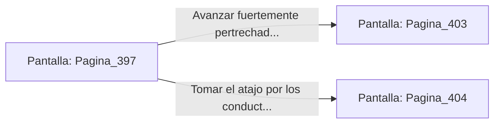

# 📺 Nodo Pantalla: `Pagina_397`

[[Index|⬅️ Índice]] | Fichero Origen: [[sample_eligejuego-code_capitulo_21_mpl|📄 sample/eligejuego-code/capitulo_21.mpl]]

**Narrativa y Encabezado:**
> PÁGINA 397: REPERTORIO DE ENERGÍA
> 
> Fuerzas la cerradura de la caja de pertrechos usando tu estaca rúnica. La tapa se levanta revelando dos Células de Éter Sobrecargadas intactas y una granada de humo denso.
> 
> Sincronizas las células con la cámara de energía de tu arma de fase y guardas la granada en tu cinturón táctico, sintiendo tu potencial de combate restaurado al máximo.
> 
> Con el equipo renovado, retomas la marcha hacia las Bóvedas de la Legión Abisal.

## 📋 Desglose de Instrucciones de Opciones
### `OPCION "Avanzar fuertemente pertrechado hacia las Bóvedas de la Legión" CON_ACCION TRANSICIONAR_A Pagina_403`
* **Instrucción:** `OPCION` *(Manual: Mapea una entrada o botón interactivo de usuario. Vincular una acción como la invocación de una función C1, un método C2 o una transición C3.)*
* **Efecto de Control:** Dispara `TRANSICIONAR_A` hacia [[Pantalla_Pagina_403|📺 Pagina_403]]
### `OPCION "Tomar el atajo por los conductos de ventilación superiores" CON_ACCION TRANSICIONAR_A Pagina_404`
* **Instrucción:** `OPCION` *(Manual: Mapea una entrada o botón interactivo de usuario. Vincular una acción como la invocación de una función C1, un método C2 o una transición C3.)*
* **Efecto de Control:** Dispara `TRANSICIONAR_A` hacia [[Pantalla_Pagina_404|📺 Pagina_404]]

## 📊 Diagrama de Flujo e Interacción (Mermaid)

