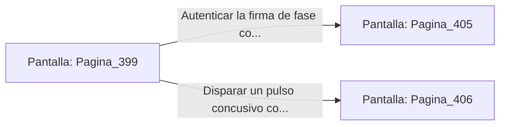

# 📺 Nodo Pantalla: `Pagina_399`

[[Index|⬅️ Índice]] | Fichero Origen: [[sample_eligejuego-code_capitulo_21_mpl|📄 sample/eligejuego-code/capitulo_21.mpl]]

**Narrativa y Encabezado:**
> PÁGINA 399: EL ASCENSOR DEL ABISMO
> 
> La plataforma del ascensor de carga desciende velozmente por el pozo vertical iluminado por anillos de luz azulina. A través de la estructura abierta ves pasar las gigantescas tuberías que alimentan el sistema de refrigeración del sector.
> 
> En el Nivel Dos, el ascensor se detiene frente a un portón acorazado que custodia la Sala del Generador Abisal. Las luces de la puerta parpadean en amarillo, solicitando la validación de una firma de fase válida.
> 
> Tienes la opción de autenticar la firma con tu Brazal de Convergencia o forzar el panel mediante un pulso concusivo.

## 📋 Desglose de Instrucciones de Opciones
### `OPCION "Autenticar la firma de fase con el Brazal de Convergencia" CON_ACCION TRANSICIONAR_A Pagina_405`
* **Instrucción:** `OPCION` *(Manual: Mapea una entrada o botón interactivo de usuario. Vincular una acción como la invocación de una función C1, un método C2 o una transición C3.)*
* **Efecto de Control:** Dispara `TRANSICIONAR_A` hacia [[Pantalla_Pagina_405|📺 Pagina_405]]
### `OPCION "Disparar un pulso concusivo contra el panel de la puerta" CON_ACCION TRANSICIONAR_A Pagina_406`
* **Instrucción:** `OPCION` *(Manual: Mapea una entrada o botón interactivo de usuario. Vincular una acción como la invocación de una función C1, un método C2 o una transición C3.)*
* **Efecto de Control:** Dispara `TRANSICIONAR_A` hacia [[Pantalla_Pagina_406|📺 Pagina_406]]

## 📊 Diagrama de Flujo e Interacción (Mermaid)

