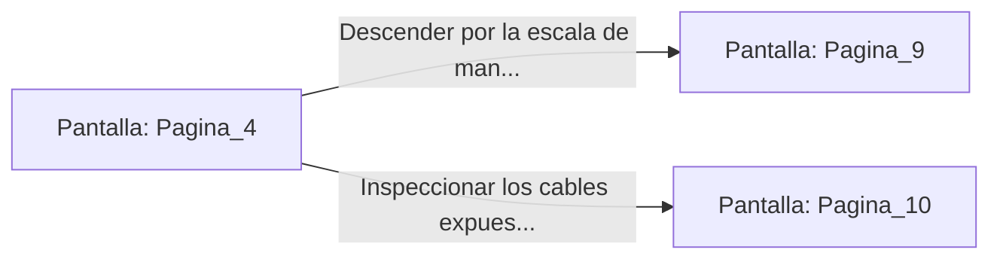

# 📺 Nodo Pantalla: `Pagina_4`

[[Index|⬅️ Índice]] | Fichero Origen: [[sample_eligejuego-code_capitulo_01_mpl|📄 sample/eligejuego-code/capitulo_01.mpl]]

**Narrativa y Encabezado:**
> PÁGINA 4: EL PANEL RÚNICO
> 
> Te aproximas a la escotilla neumática e introduces la mano en la ranura de interfaz del panel. Las runas brillan con furia cegadora y el mecanismo hidráulico se activa con un chasquido sordo, abriendo un acceso directo a los túneles de mantenimiento del sector inferior.

## 📋 Desglose de Instrucciones de Opciones
### `OPCION "Descender por la escala de mano metálica hacia el Sector Inferior" CON_ACCION TRANSICIONAR_A Pagina_9`
* **Instrucción:** `OPCION` *(Manual: Mapea una entrada o botón interactivo de usuario. Vincular una acción como la invocación de una función C1, un método C2 o una transición C3.)*
* **Efecto de Control:** Dispara `TRANSICIONAR_A` hacia [[Pantalla_Pagina_9|📺 Pagina_9]]
### `OPCION "Inspeccionar los cables expuestos del panel antes de bajar" CON_ACCION TRANSICIONAR_A Pagina_10`
* **Instrucción:** `OPCION` *(Manual: Mapea una entrada o botón interactivo de usuario. Vincular una acción como la invocación de una función C1, un método C2 o una transición C3.)*
* **Efecto de Control:** Dispara `TRANSICIONAR_A` hacia [[Pantalla_Pagina_10|📺 Pagina_10]]

## 📊 Diagrama de Flujo e Interacción (Mermaid)

