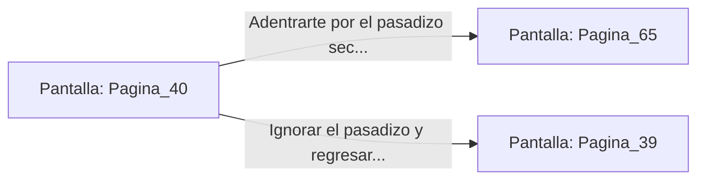

# 📺 Nodo Pantalla: `Pagina_40`

[[Index|⬅️ Índice]] | Fichero Origen: [[sample_eligejuego-code_capitulo_03_mpl|📄 sample/eligejuego-code/capitulo_03.mpl]]

**Narrativa y Encabezado:**
> PÁGINA 40: EL PASAJE OCULTO DE LOS BAJORRELIEVES
> 
> Presionas el ojo tallado de uno de los reyes en el mural de mármol. Un bloque de piedra se retrae en la pared, revelando un pasadizo secreto que desciende en fuerte pendiente.
> 
> Al final del túnel secreto se escucha el rugido de corriente de agua y el chispazo de generadores arcanos.

## 📋 Desglose de Instrucciones de Opciones
### `OPCION "Adentrarte por el pasadizo secreto hacia los generadores" CON_ACCION TRANSICIONAR_A Pagina_65`
* **Instrucción:** `OPCION` *(Manual: Mapea una entrada o botón interactivo de usuario. Vincular una acción como la invocación de una función C1, un método C2 o una transición C3.)*
* **Efecto de Control:** Dispara `TRANSICIONAR_A` hacia [[Pantalla_Pagina_65|📺 Pagina_65]]
### `OPCION "Ignorar el pasadizo y regresar al pórtico principal" CON_ACCION TRANSICIONAR_A Pagina_39`
* **Instrucción:** `OPCION` *(Manual: Mapea una entrada o botón interactivo de usuario. Vincular una acción como la invocación de una función C1, un método C2 o una transición C3.)*
* **Efecto de Control:** Dispara `TRANSICIONAR_A` hacia [[Pantalla_Pagina_39|📺 Pagina_39]]

## 📊 Diagrama de Flujo e Interacción (Mermaid)

