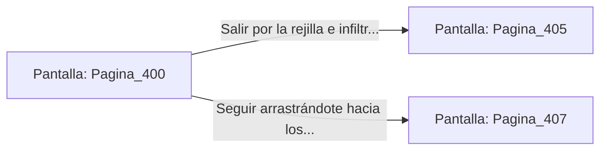

# 📺 Nodo Pantalla: `Pagina_400`

[[Index|⬅️ Índice]] | Fichero Origen: [[sample_eligejuego-code_capitulo_21_mpl|📄 sample/eligejuego-code/capitulo_21.mpl]]

**Narrativa y Encabezado:**
> PÁGINA 400: EL CONDUCTO DE MANTENIMIENTO
> 
> Te deslizas por el angosto conducto de mantenimiento metálico. El polvo acumulado rechina bajo tu armadura mientras te arrastras con sigilo rodeando la zona de patrulla principal.
> 
> Emerges por una rejilla directamente tras la barricada defensiva del Generador Abisal.

## 📋 Desglose de Instrucciones de Opciones
### `OPCION "Salir por la rejilla e infiltrarte en la Sala del Generador" CON_ACCION TRANSICIONAR_A Pagina_405`
* **Instrucción:** `OPCION` *(Manual: Mapea una entrada o botón interactivo de usuario. Vincular una acción como la invocación de una función C1, un método C2 o una transición C3.)*
* **Efecto de Control:** Dispara `TRANSICIONAR_A` hacia [[Pantalla_Pagina_405|📺 Pagina_405]]
### `OPCION "Seguir arrastrándote hacia los laboratorios inferiores" CON_ACCION TRANSICIONAR_A Pagina_407`
* **Instrucción:** `OPCION` *(Manual: Mapea una entrada o botón interactivo de usuario. Vincular una acción como la invocación de una función C1, un método C2 o una transición C3.)*
* **Efecto de Control:** Dispara `TRANSICIONAR_A` hacia [[Pantalla_Pagina_407|📺 Pagina_407]]

## 📊 Diagrama de Flujo e Interacción (Mermaid)

