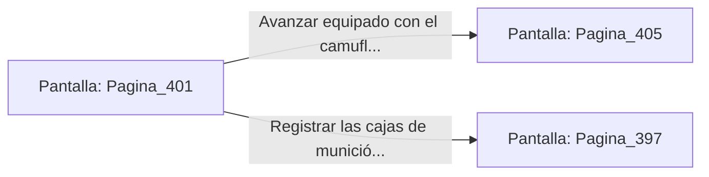

# 📺 Nodo Pantalla: `Pagina_401`

[[Index|⬅️ Índice]] | Fichero Origen: [[sample_eligejuego-code_capitulo_21_mpl|📄 sample/eligejuego-code/capitulo_21.mpl]]

**Narrativa y Encabezado:**
> PÁGINA 401: LOS DEPÓSITOS DE LA LEGIÓN
> 
> Subes por la escalera metálica y accedes a los vastos depósitos de la Legión Abisal. Bastidores llenos de fusiles de pulso, escudos de fase y arneses tácticos se extienden bajo la bóveda de basalto.
> 
> En el centro de la nave encuentras un uniforme de camuflaje térmico completo y un vial de suero medico regenerativo concentrado.
> 
> Consumes el suero para sanar tus heridas y te equipas con el camuflaje térmico antes de continuar hacia el núcleo del sector.

## 📋 Desglose de Instrucciones de Opciones
### `OPCION "Avanzar equipado con el camuflaje térmico al Generador Abisal" CON_ACCION TRANSICIONAR_A Pagina_405`
* **Instrucción:** `OPCION` *(Manual: Mapea una entrada o botón interactivo de usuario. Vincular una acción como la invocación de una función C1, un método C2 o una transición C3.)*
* **Efecto de Control:** Dispara `TRANSICIONAR_A` hacia [[Pantalla_Pagina_405|📺 Pagina_405]]
### `OPCION "Registrar las cajas de munición pesada del depósito" CON_ACCION TRANSICIONAR_A Pagina_397`
* **Instrucción:** `OPCION` *(Manual: Mapea una entrada o botón interactivo de usuario. Vincular una acción como la invocación de una función C1, un método C2 o una transición C3.)*
* **Efecto de Control:** Dispara `TRANSICIONAR_A` hacia [[Pantalla_Pagina_397|📺 Pagina_397]]

## 📊 Diagrama de Flujo e Interacción (Mermaid)

