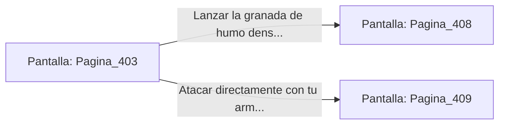

# 📺 Nodo Pantalla: `Pagina_403`

[[Index|⬅️ Índice]] | Fichero Origen: [[sample_eligejuego-code_capitulo_21_mpl|📄 sample/eligejuego-code/capitulo_21.mpl]]

**Narrativa y Encabezado:**
> PÁGINA 403: LAS BÓVEDAS DE LA LEGIÓN
> 
> Entras en las Bóvedas de la Legión Abisal portando tu equipo al máximo rendimiento. Las paredes revestidas de titanio reflejan el resplandor de las luces de emergencia que parpadean en el techo.
> 
> Una patrulla de dos autómatas pesados custodia el acceso a la sala de mando. Al percatarse de tu presencia, activan sus cañones de plasma y se disponen a abrir fuego.
> 
> Puedes usar tu granada de humo denso para cegar sus visores tácticos o atacarlos directamente con la potencia sobrecargada de tu arma de fase.

## 📋 Desglose de Instrucciones de Opciones
### `OPCION "Lanzar la granada de humo denso para inutilizar sus visores" CON_ACCION TRANSICIONAR_A Pagina_408`
* **Instrucción:** `OPCION` *(Manual: Mapea una entrada o botón interactivo de usuario. Vincular una acción como la invocación de una función C1, un método C2 o una transición C3.)*
* **Efecto de Control:** Dispara `TRANSICIONAR_A` hacia [[Pantalla_Pagina_408|📺 Pagina_408]]
### `OPCION "Atacar directamente con tu arma de fase sobrecargada" CON_ACCION TRANSICIONAR_A Pagina_409`
* **Instrucción:** `OPCION` *(Manual: Mapea una entrada o botón interactivo de usuario. Vincular una acción como la invocación de una función C1, un método C2 o una transición C3.)*
* **Efecto de Control:** Dispara `TRANSICIONAR_A` hacia [[Pantalla_Pagina_409|📺 Pagina_409]]

## 📊 Diagrama de Flujo e Interacción (Mermaid)

