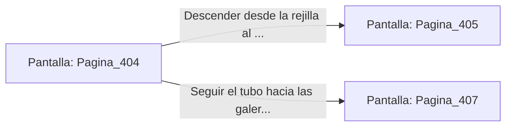

# 📺 Nodo Pantalla: `Pagina_404`

[[Index|⬅️ Índice]] | Fichero Origen: [[sample_eligejuego-code_capitulo_21_mpl|📄 sample/eligejuego-code/capitulo_21.mpl]]

**Narrativa y Encabezado:**
> PÁGINA 404: VENTILACIÓN SUPERIOR
> 
> Avanzas por los tubos de ventilación superiores disfrutando de una posición elevada sobre las patrullas del abismo. El flujo de aire frío mantiene las lecturas de tu armadura estables.
> 
> Alcanzas una rejilla que da acceso directo al techo del Generador Abisal.

## 📋 Desglose de Instrucciones de Opciones
### `OPCION "Descender desde la rejilla al techo del Generador Abisal" CON_ACCION TRANSICIONAR_A Pagina_405`
* **Instrucción:** `OPCION` *(Manual: Mapea una entrada o botón interactivo de usuario. Vincular una acción como la invocación de una función C1, un método C2 o una transición C3.)*
* **Efecto de Control:** Dispara `TRANSICIONAR_A` hacia [[Pantalla_Pagina_405|📺 Pagina_405]]
### `OPCION "Seguir el tubo hacia las galerías de cristal" CON_ACCION TRANSICIONAR_A Pagina_407`
* **Instrucción:** `OPCION` *(Manual: Mapea una entrada o botón interactivo de usuario. Vincular una acción como la invocación de una función C1, un método C2 o una transición C3.)*
* **Efecto de Control:** Dispara `TRANSICIONAR_A` hacia [[Pantalla_Pagina_407|📺 Pagina_407]]

## 📊 Diagrama de Flujo e Interacción (Mermaid)

