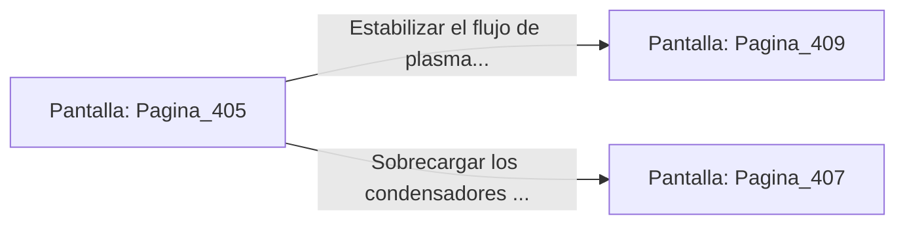

# 📺 Nodo Pantalla: `Pagina_405`

[[Index|⬅️ Índice]] | Fichero Origen: [[sample_eligejuego-code_capitulo_21_mpl|📄 sample/eligejuego-code/capitulo_21.mpl]]

**Narrativa y Encabezado:**
> PÁGINA 405: LA SALA DEL GENERADOR ABISAL
> 
> Ingresas a la majestuosa Sala del Generador Abisal. En el centro de la nave, una inmensa columna de fuego violeta gira a revoluciones vertiginosas dentro de un cilindro de cuarzo reforzado, produciendo la energía que alimenta las Cámaras 406 a 430.
> 
> En la consola de control principal brilla la Tarjeta de Nivel Cuatro y un conmutador que permite estabilizar el flujo de plasma o sobrecargar los condensadores del sector.
> 
> Sincronizas la Tarjeta de Nivel Cuatro en tu Brazal de Convergencia antes de tomar una decisión sobre el estado del generador.

## 📋 Desglose de Instrucciones de Opciones
### `OPCION "Estabilizar el flujo de plasma en la consola central" CON_ACCION TRANSICIONAR_A Pagina_409`
* **Instrucción:** `OPCION` *(Manual: Mapea una entrada o botón interactivo de usuario. Vincular una acción como la invocación de una función C1, un método C2 o una transición C3.)*
* **Efecto de Control:** Dispara `TRANSICIONAR_A` hacia [[Pantalla_Pagina_409|📺 Pagina_409]]
### `OPCION "Sobrecargar los condensadores para provocar un apagón en la zona" CON_ACCION TRANSICIONAR_A Pagina_407`
* **Instrucción:** `OPCION` *(Manual: Mapea una entrada o botón interactivo de usuario. Vincular una acción como la invocación de una función C1, un método C2 o una transición C3.)*
* **Efecto de Control:** Dispara `TRANSICIONAR_A` hacia [[Pantalla_Pagina_407|📺 Pagina_407]]

## 📊 Diagrama de Flujo e Interacción (Mermaid)

