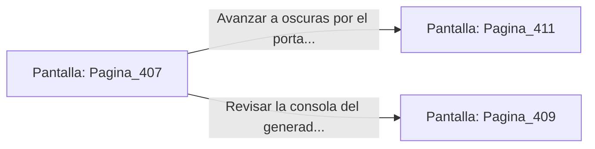

# 📺 Nodo Pantalla: `Pagina_407`

[[Index|⬅️ Índice]] | Fichero Origen: [[sample_eligejuego-code_capitulo_21_mpl|📄 sample/eligejuego-code/capitulo_21.mpl]]

**Narrativa y Encabezado:**
> PÁGINA 407: SOBRECARGA EN EL GENERADOR ABISAL
> 
> Manipulas los controles de la consola y fuerzas la sobrecarga de los condensadores. La columna de fuego violeta emite un zumbido agudo antes de apagarse con un sordo chasquido térmico, sumiendo a todo el sector en la penumbra.
> 
> Sin suministro eléctrico, las torretas automáticas y los escudos de fase de los pasillos superiores quedan desactivados por completo.
> 
> Aprovechas la oscuridad para avanzar a paso ligero hacia el portal que da acceso a las Cámaras del Capítulo 22.

## 📋 Desglose de Instrucciones de Opciones
### `OPCION "Avanzar a oscuras por el portal despejado hacia el Capítulo 22" CON_ACCION TRANSICIONAR_A Pagina_411`
* **Instrucción:** `OPCION` *(Manual: Mapea una entrada o botón interactivo de usuario. Vincular una acción como la invocación de una función C1, un método C2 o una transición C3.)*
* **Efecto de Control:** Dispara `TRANSICIONAR_A` hacia [[Pantalla_Pagina_411|📺 Pagina_411]]
### `OPCION "Revisar la consola del generador con tu visera táctica" CON_ACCION TRANSICIONAR_A Pagina_409`
* **Instrucción:** `OPCION` *(Manual: Mapea una entrada o botón interactivo de usuario. Vincular una acción como la invocación de una función C1, un método C2 o una transición C3.)*
* **Efecto de Control:** Dispara `TRANSICIONAR_A` hacia [[Pantalla_Pagina_409|📺 Pagina_409]]

## 📊 Diagrama de Flujo e Interacción (Mermaid)

