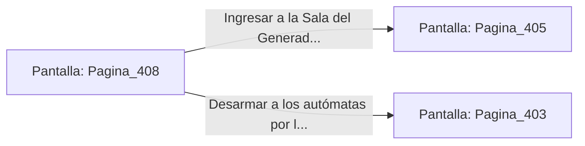

# 📺 Nodo Pantalla: `Pagina_408`

[[Index|⬅️ Índice]] | Fichero Origen: [[sample_eligejuego-code_capitulo_21_mpl|📄 sample/eligejuego-code/capitulo_21.mpl]]

**Narrativa y Encabezado:**
> PÁGINA 408: AVANCE EN LA NIEBLA DE HUMO
> 
> Lanzas la granada de humo denso e inunda la bóveda con una espesa cortina opaca. Los autómatas pesados pierden la fijación de sus visores térmicos y disparan a ciegas contra la pared.
> 
> Cruzas corriendo la nave por el flanco izquierdo y alcanzas la puerta de la Sala del Generador sin sufrir daño alguno.

## 📋 Desglose de Instrucciones de Opciones
### `OPCION "Ingresar a la Sala del Generador Abisal" CON_ACCION TRANSICIONAR_A Pagina_405`
* **Instrucción:** `OPCION` *(Manual: Mapea una entrada o botón interactivo de usuario. Vincular una acción como la invocación de una función C1, un método C2 o una transición C3.)*
* **Efecto de Control:** Dispara `TRANSICIONAR_A` hacia [[Pantalla_Pagina_405|📺 Pagina_405]]
### `OPCION "Desarmar a los autómatas por la espalda en el humo" CON_ACCION TRANSICIONAR_A Pagina_403`
* **Instrucción:** `OPCION` *(Manual: Mapea una entrada o botón interactivo de usuario. Vincular una acción como la invocación de una función C1, un método C2 o una transición C3.)*
* **Efecto de Control:** Dispara `TRANSICIONAR_A` hacia [[Pantalla_Pagina_403|📺 Pagina_403]]

## 📊 Diagrama de Flujo e Interacción (Mermaid)

