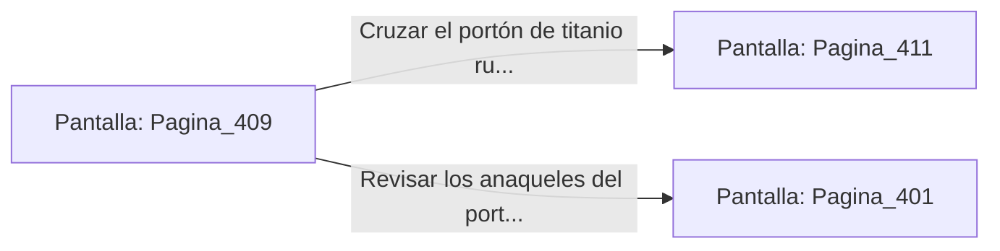

# 📺 Nodo Pantalla: `Pagina_409`

[[Index|⬅️ Índice]] | Fichero Origen: [[sample_eligejuego-code_capitulo_21_mpl|📄 sample/eligejuego-code/capitulo_21.mpl]]

**Narrativa y Encabezado:**
> PÁGINA 409: EL PASO A LAS CÁMARAS DEL CAPÍTULO 22
> 
> Con la Tarjeta de Nivel Cuatro sincronizada y el flujo de plasma estabilizado en parámetros seguros, el gran portón de titanio de la pared norte se abre suavemente en dos mitades.
> 
> Ante ti se despliega la calzada iluminada que conduce a las Cámaras del Capítulo 22, donde aguardan los antiguos laboratorios de investigación mnemónica de Aethelgard.
> 
> Te detienes un instante a verificar la munición y el estado médico de tu equipo antes de cruzar el umbral con determinación.

## 📋 Desglose de Instrucciones de Opciones
### `OPCION "Cruzar el portón de titanio rumbo al Capítulo 22" CON_ACCION TRANSICIONAR_A Pagina_411`
* **Instrucción:** `OPCION` *(Manual: Mapea una entrada o botón interactivo de usuario. Vincular una acción como la invocación de una función C1, un método C2 o una transición C3.)*
* **Efecto de Control:** Dispara `TRANSICIONAR_A` hacia [[Pantalla_Pagina_411|📺 Pagina_411]]
### `OPCION "Revisar los anaqueles del portón en busca de suministros" CON_ACCION TRANSICIONAR_A Pagina_401`
* **Instrucción:** `OPCION` *(Manual: Mapea una entrada o botón interactivo de usuario. Vincular una acción como la invocación de una función C1, un método C2 o una transición C3.)*
* **Efecto de Control:** Dispara `TRANSICIONAR_A` hacia [[Pantalla_Pagina_401|📺 Pagina_401]]

## 📊 Diagrama de Flujo e Interacción (Mermaid)

