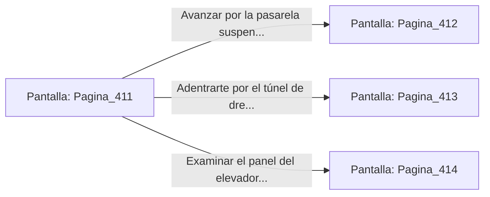

# 📺 Nodo Pantalla: `Pagina_411`

[[Index|⬅️ Índice]] | Fichero Origen: [[sample_eligejuego-code_capitulo_22_mpl|📄 sample/eligejuego-code/capitulo_22.mpl]]

**Narrativa y Encabezado:**
> PÁGINA 411: LOS LABORATORIOS MNEMÓNICOS
> 
> Atraviesas el portón de titanio y accedes a la inmensa nave de los Laboratorios de Investigación Mnemónica. Tubos de cristal translúcido llenos de suero sintético se alinean en las paredes, conservando en su interior fragmentos de memorias extraídas durante los experimentos de la antigua dinastía de Aethelgard.
> 
> Tu Brazal de Convergencia registra que las vibraciones de las Cámaras 411 a 430 forman el núcleo de procesamiento de datos de la ciudadela. Unidades de análisis biomecánicas patrullan los pasillos elevados, escaneando el aire en busca de firmas no autorizadas.
> 
> Frente a ti se despliegan tres vías de avance: una pasarela suspendida que cruza la sala de tanques, un túnel de drenaje de reactivos y un elevador de servicio protegido por una barrera de energía.

## 📋 Desglose de Instrucciones de Opciones
### `OPCION "Avanzar por la pasarela suspendida sobre los tanques de suero" CON_ACCION TRANSICIONAR_A Pagina_412`
* **Instrucción:** `OPCION` *(Manual: Mapea una entrada o botón interactivo de usuario. Vincular una acción como la invocación de una función C1, un método C2 o una transición C3.)*
* **Efecto de Control:** Dispara `TRANSICIONAR_A` hacia [[Pantalla_Pagina_412|📺 Pagina_412]]
### `OPCION "Adentrarte por el túnel de drenaje de reactivos" CON_ACCION TRANSICIONAR_A Pagina_413`
* **Instrucción:** `OPCION` *(Manual: Mapea una entrada o botón interactivo de usuario. Vincular una acción como la invocación de una función C1, un método C2 o una transición C3.)*
* **Efecto de Control:** Dispara `TRANSICIONAR_A` hacia [[Pantalla_Pagina_413|📺 Pagina_413]]
### `OPCION "Examinar el panel del elevador de servicio protegido" CON_ACCION TRANSICIONAR_A Pagina_414`
* **Instrucción:** `OPCION` *(Manual: Mapea una entrada o botón interactivo de usuario. Vincular una acción como la invocación de una función C1, un método C2 o una transición C3.)*
* **Efecto de Control:** Dispara `TRANSICIONAR_A` hacia [[Pantalla_Pagina_414|📺 Pagina_414]]

## 📊 Diagrama de Flujo e Interacción (Mermaid)

