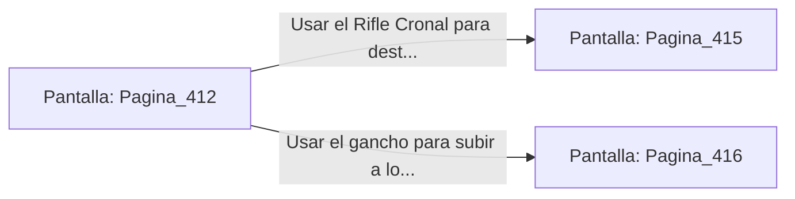

# 📺 Nodo Pantalla: `Pagina_412`

[[Index|⬅️ Índice]] | Fichero Origen: [[sample_eligejuego-code_capitulo_22_mpl|📄 sample/eligejuego-code/capitulo_22.mpl]]

**Narrativa y Encabezado:**
> PÁGINA 412: LA PASARELA DE LOS TANQUES
> 
> Avanzas a paso ligero por la rejilla metálica mientras los tanques de suero mnemónico emiten un débil resplandor violeta a tus pies. La humedad del ambiente condensa gotas de reactivo que caen sobre las losas con un chasquido rítmico.
> 
> A mitad de la travesía, dos unidades de análisis biomecánicas emergen de la penumbra y despliegan sus proyectores de luz estigmática.

## 📋 Desglose de Instrucciones de Opciones
### `OPCION "Usar el Rifle Cronal para destruir los proyectores de las unidades" CON_ACCION TRANSICIONAR_A Pagina_415`
* **Instrucción:** `OPCION` *(Manual: Mapea una entrada o botón interactivo de usuario. Vincular una acción como la invocación de una función C1, un método C2 o una transición C3.)*
* **Efecto de Control:** Dispara `TRANSICIONAR_A` hacia [[Pantalla_Pagina_415|📺 Pagina_415]]
### `OPCION "Usar el gancho para subir a los tubos de ventilación superiores" CON_ACCION TRANSICIONAR_A Pagina_416`
* **Instrucción:** `OPCION` *(Manual: Mapea una entrada o botón interactivo de usuario. Vincular una acción como la invocación de una función C1, un método C2 o una transición C3.)*
* **Efecto de Control:** Dispara `TRANSICIONAR_A` hacia [[Pantalla_Pagina_416|📺 Pagina_416]]

## 📊 Diagrama de Flujo e Interacción (Mermaid)

