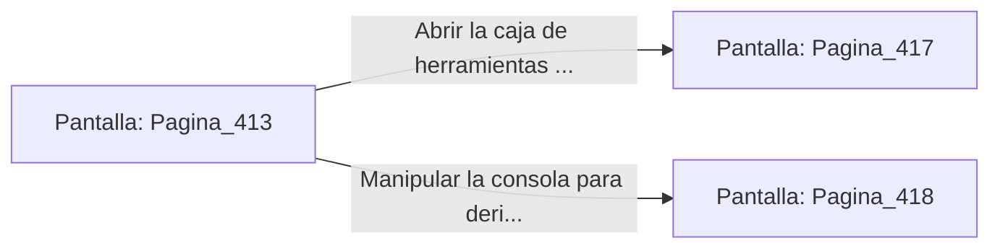

# 📺 Nodo Pantalla: `Pagina_413`

[[Index|⬅️ Índice]] | Fichero Origen: [[sample_eligejuego-code_capitulo_22_mpl|📄 sample/eligejuego-code/capitulo_22.mpl]]

**Narrativa y Encabezado:**
> PÁGINA 413: EL TÚNEL DE DRENAJE DE REACTIVOS
> 
> Te introduces en el angosto túnel de piedra pulida por el que discurre un canal de reactivo alcalino. El aire huele a ácido concentrado y sales rúnicas, obligando a los filtros de tu visera a trabajar a pleno rendimiento.
> 
> Avanzas pegado a la pared para evitar las salpicaduras hasta alcanzar una cámara de distribución iluminada por un terminal activo. Sobre una mesa de trabajo descansa una caja de herramientas de los antiguos alquimistas.
> 
> Tienes la oportunidad de abrir la caja en busca de viales de salud o manipular la consola para derivar el flujo de ácido lejos de tu camino.

## 📋 Desglose de Instrucciones de Opciones
### `OPCION "Abrir la caja de herramientas alquímicas" CON_ACCION TRANSICIONAR_A Pagina_417`
* **Instrucción:** `OPCION` *(Manual: Mapea una entrada o botón interactivo de usuario. Vincular una acción como la invocación de una función C1, un método C2 o una transición C3.)*
* **Efecto de Control:** Dispara `TRANSICIONAR_A` hacia [[Pantalla_Pagina_417|📺 Pagina_417]]
### `OPCION "Manipular la consola para derivar el flujo de ácido" CON_ACCION TRANSICIONAR_A Pagina_418`
* **Instrucción:** `OPCION` *(Manual: Mapea una entrada o botón interactivo de usuario. Vincular una acción como la invocación de una función C1, un método C2 o una transición C3.)*
* **Efecto de Control:** Dispara `TRANSICIONAR_A` hacia [[Pantalla_Pagina_418|📺 Pagina_418]]

## 📊 Diagrama de Flujo e Interacción (Mermaid)

