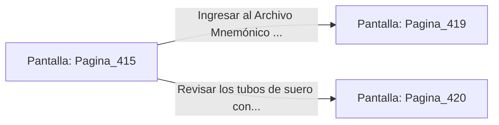

# 📺 Nodo Pantalla: `Pagina_415`

[[Index|⬅️ Índice]] | Fichero Origen: [[sample_eligejuego-code_capitulo_22_mpl|📄 sample/eligejuego-code/capitulo_22.mpl]]

**Narrativa y Encabezado:**
> PÁGINA 415: FUEGO PRECISO EN LA PASARELA
> 
> Alineas la mira de tu Rifle Cronal y disparas dos ráfagas de aceleración concisa. Los proyectiles impactan de lleno en las lentes de los proyectores, haciendo estallar a las dos unidades biomecánicas en una lluvia de chispas y piezas metálicas.
> 
> Con la pasarela despejada, alcanzas el descansillo del fondo donde un armario blindado de repuesto permanece entreabierto. En su interior hallas dos Células de Éter Sobrecargadas y una tarjeta de acceso al Archivo Central.
> 
> Guardas los componentes en tu arnés táctico antes de cruzar la puerta que conduce al Archivo Mnemónico.

## 📋 Desglose de Instrucciones de Opciones
### `OPCION "Ingresar al Archivo Mnemónico con la tarjeta de acceso" CON_ACCION TRANSICIONAR_A Pagina_419`
* **Instrucción:** `OPCION` *(Manual: Mapea una entrada o botón interactivo de usuario. Vincular una acción como la invocación de una función C1, un método C2 o una transición C3.)*
* **Efecto de Control:** Dispara `TRANSICIONAR_A` hacia [[Pantalla_Pagina_419|📺 Pagina_419]]
### `OPCION "Revisar los tubos de suero contiguos al armario" CON_ACCION TRANSICIONAR_A Pagina_420`
* **Instrucción:** `OPCION` *(Manual: Mapea una entrada o botón interactivo de usuario. Vincular una acción como la invocación de una función C1, un método C2 o una transición C3.)*
* **Efecto de Control:** Dispara `TRANSICIONAR_A` hacia [[Pantalla_Pagina_420|📺 Pagina_420]]

## 📊 Diagrama de Flujo e Interacción (Mermaid)

