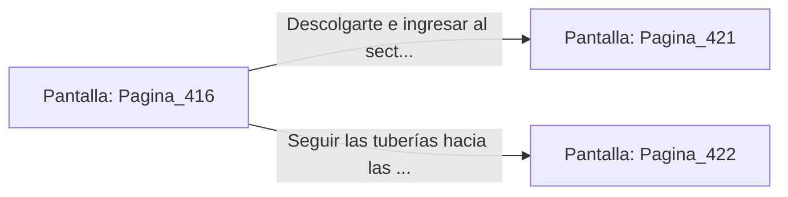

# 📺 Nodo Pantalla: `Pagina_416`

[[Index|⬅️ Índice]] | Fichero Origen: [[sample_eligejuego-code_capitulo_22_mpl|📄 sample/eligejuego-code/capitulo_22.mpl]]

**Narrativa y Encabezado:**
> PÁGINA 416: EVASIÓN POR LOS TUBOS SUPERIORES
> 
> Disparas el gancho y te elevas hacia las tuberías del techo, esquivando el barrido de luz de las unidades de análisis. Avanzas arrastrándote por la estructura metálica hasta superar la zona de patrulla.
> 
> Te descuelgas al otro lado de la pasarela frente a la entrada del sector de pruebas.

## 📋 Desglose de Instrucciones de Opciones
### `OPCION "Descolgarte e ingresar al sector de pruebas" CON_ACCION TRANSICIONAR_A Pagina_421`
* **Instrucción:** `OPCION` *(Manual: Mapea una entrada o botón interactivo de usuario. Vincular una acción como la invocación de una función C1, un método C2 o una transición C3.)*
* **Efecto de Control:** Dispara `TRANSICIONAR_A` hacia [[Pantalla_Pagina_421|📺 Pagina_421]]
### `OPCION "Seguir las tuberías hacia las bóvedas de almacenamiento" CON_ACCION TRANSICIONAR_A Pagina_422`
* **Instrucción:** `OPCION` *(Manual: Mapea una entrada o botón interactivo de usuario. Vincular una acción como la invocación de una función C1, un método C2 o una transición C3.)*
* **Efecto de Control:** Dispara `TRANSICIONAR_A` hacia [[Pantalla_Pagina_422|📺 Pagina_422]]

## 📊 Diagrama de Flujo e Interacción (Mermaid)

