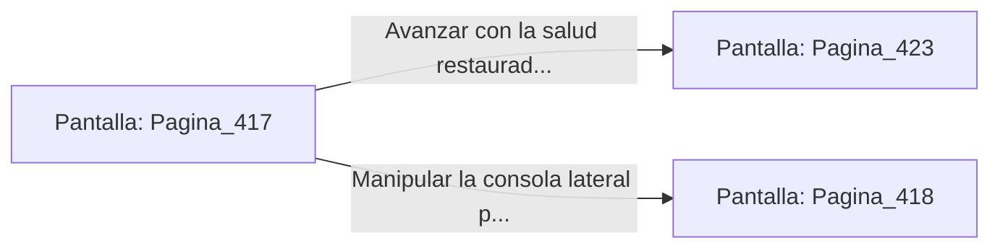

# 📺 Nodo Pantalla: `Pagina_417`

[[Index|⬅️ Índice]] | Fichero Origen: [[sample_eligejuego-code_capitulo_22_mpl|📄 sample/eligejuego-code/capitulo_22.mpl]]

**Narrativa y Encabezado:**
> PÁGINA 417: SUMINISTROS ALQUÍMICOS RECUPERADOS
> 
> Fuerzas el cierre de la caja de herramientas con tu estaca rúnica. La tapa cede revelando dos viales de Suero Reconstituyente y una bomba de pulso electromagnético concentrado.
> 
> Consumes una de las dosis de suero, sintiendo una agradable vibración cálida que repara el desgaste de tus tejidos y restablece la vitalidad máxima de tu armadura.
> 
> Con los frascos a buen recaudo en tu cinturón, te dispones a reanudar la marcha hacia la sala de distribución mnemónica.

## 📋 Desglose de Instrucciones de Opciones
### `OPCION "Avanzar con la salud restaurada hacia la sala de distribución" CON_ACCION TRANSICIONAR_A Pagina_423`
* **Instrucción:** `OPCION` *(Manual: Mapea una entrada o botón interactivo de usuario. Vincular una acción como la invocación de una función C1, un método C2 o una transición C3.)*
* **Efecto de Control:** Dispara `TRANSICIONAR_A` hacia [[Pantalla_Pagina_423|📺 Pagina_423]]
### `OPCION "Manipular la consola lateral para purgar el canal de reactivo" CON_ACCION TRANSICIONAR_A Pagina_418`
* **Instrucción:** `OPCION` *(Manual: Mapea una entrada o botón interactivo de usuario. Vincular una acción como la invocación de una función C1, un método C2 o una transición C3.)*
* **Efecto de Control:** Dispara `TRANSICIONAR_A` hacia [[Pantalla_Pagina_418|📺 Pagina_418]]

## 📊 Diagrama de Flujo e Interacción (Mermaid)

