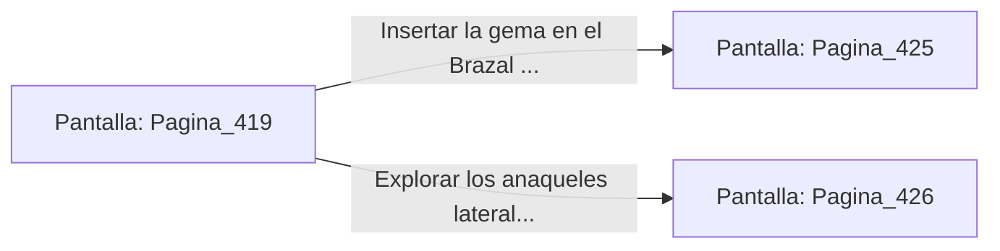

# 📺 Nodo Pantalla: `Pagina_419`

[[Index|⬅️ Índice]] | Fichero Origen: [[sample_eligejuego-code_capitulo_22_mpl|📄 sample/eligejuego-code/capitulo_22.mpl]]

**Narrativa y Encabezado:**
> PÁGINA 419: EL ARCHIVO MNEMÓNICO CENTRAL
> 
> Deslizas la tarjeta de acceso por el lector rúnico e ingresas a la vasta estancia del Archivo Mnemónico Central. Cintas de luz holográfica flotan entre atriles de obsidiana, proyectando registros históricos de las primeras fases de la construcción de Aethelgard.
> 
> En la consola principal brilla una gema de cristal de lectura y una clave de anulación que permite desactivar las trampas del sector colindante.
> 
> Tienes la opción de insertar la gema en tu Brazal para procesar los datos de la clave o explorar los anaqueles laterales en busca de esquemas de armas.

## 📋 Desglose de Instrucciones de Opciones
### `OPCION "Insertar la gema en el Brazal para procesar la clave de anulación" CON_ACCION TRANSICIONAR_A Pagina_425`
* **Instrucción:** `OPCION` *(Manual: Mapea una entrada o botón interactivo de usuario. Vincular una acción como la invocación de una función C1, un método C2 o una transición C3.)*
* **Efecto de Control:** Dispara `TRANSICIONAR_A` hacia [[Pantalla_Pagina_425|📺 Pagina_425]]
### `OPCION "Explorar los anaqueles laterales en busca de esquemas de armas" CON_ACCION TRANSICIONAR_A Pagina_426`
* **Instrucción:** `OPCION` *(Manual: Mapea una entrada o botón interactivo de usuario. Vincular una acción como la invocación de una función C1, un método C2 o una transición C3.)*
* **Efecto de Control:** Dispara `TRANSICIONAR_A` hacia [[Pantalla_Pagina_426|📺 Pagina_426]]

## 📊 Diagrama de Flujo e Interacción (Mermaid)

