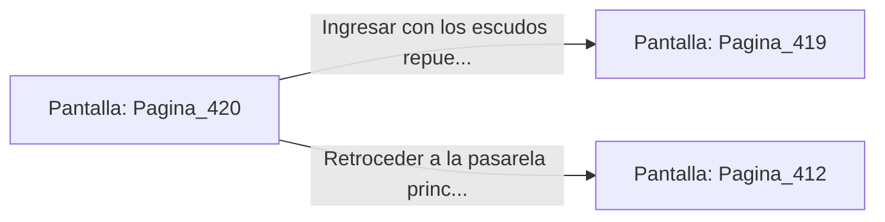

# 📺 Nodo Pantalla: `Pagina_420`

[[Index|⬅️ Índice]] | Fichero Origen: [[sample_eligejuego-code_capitulo_22_mpl|📄 sample/eligejuego-code/capitulo_22.mpl]]

**Narrativa y Encabezado:**
> PÁGINA 420: REVISIÓN DE LOS TUBOS DE SUERO
> 
> Examinas los tanques de suero contiguos al armario blindado. Entre las conducciones descubres un dispositivo de recarga rápida de escudos refractarios que adosas a tu Brazal.
> 
> Con las defensas repuestas, avanzas hacia la entrada del Archivo Mnemónico.

## 📋 Desglose de Instrucciones de Opciones
### `OPCION "Ingresar con los escudos repuestos al Archivo Mnemónico" CON_ACCION TRANSICIONAR_A Pagina_419`
* **Instrucción:** `OPCION` *(Manual: Mapea una entrada o botón interactivo de usuario. Vincular una acción como la invocación de una función C1, un método C2 o una transición C3.)*
* **Efecto de Control:** Dispara `TRANSICIONAR_A` hacia [[Pantalla_Pagina_419|📺 Pagina_419]]
### `OPCION "Retroceder a la pasarela principal" CON_ACCION TRANSICIONAR_A Pagina_412`
* **Instrucción:** `OPCION` *(Manual: Mapea una entrada o botón interactivo de usuario. Vincular una acción como la invocación de una función C1, un método C2 o una transición C3.)*
* **Efecto de Control:** Dispara `TRANSICIONAR_A` hacia [[Pantalla_Pagina_412|📺 Pagina_412]]

## 📊 Diagrama de Flujo e Interacción (Mermaid)

