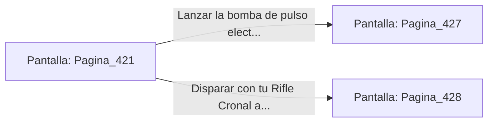

# 📺 Nodo Pantalla: `Pagina_421`

[[Index|⬅️ Índice]] | Fichero Origen: [[sample_eligejuego-code_capitulo_22_mpl|📄 sample/eligejuego-code/capitulo_22.mpl]]

**Narrativa y Encabezado:**
> PÁGINA 421: EL SECTOR DE PRUEBAS MNEMÓNICAS
> 
> Te descuelgas al piso del Sector de Pruebas Mnemónicas. En esta nave se probaban los prototipos de cascos de inducción y armas de modulación sensorial sobre autómatas de entrenamiento.
> 
> En el centro de la sala permanece activo un autómata pesado de entrenamiento cargado con un escudo de inducción mística. La unidad se gira hacia ti e inicia la secuencia de combate.
> 
> Puedes usar tu bomba de pulso electromagnético para anular su escudo o disparar a los conectores de éter situados en su espalda.

## 📋 Desglose de Instrucciones de Opciones
### `OPCION "Lanzar la bomba de pulso electromagnético contra el autómata" CON_ACCION TRANSICIONAR_A Pagina_427`
* **Instrucción:** `OPCION` *(Manual: Mapea una entrada o botón interactivo de usuario. Vincular una acción como la invocación de una función C1, un método C2 o una transición C3.)*
* **Efecto de Control:** Dispara `TRANSICIONAR_A` hacia [[Pantalla_Pagina_427|📺 Pagina_427]]
### `OPCION "Disparar con tu Rifle Cronal a los conectores de su espalda" CON_ACCION TRANSICIONAR_A Pagina_428`
* **Instrucción:** `OPCION` *(Manual: Mapea una entrada o botón interactivo de usuario. Vincular una acción como la invocación de una función C1, un método C2 o una transición C3.)*
* **Efecto de Control:** Dispara `TRANSICIONAR_A` hacia [[Pantalla_Pagina_428|📺 Pagina_428]]

## 📊 Diagrama de Flujo e Interacción (Mermaid)

