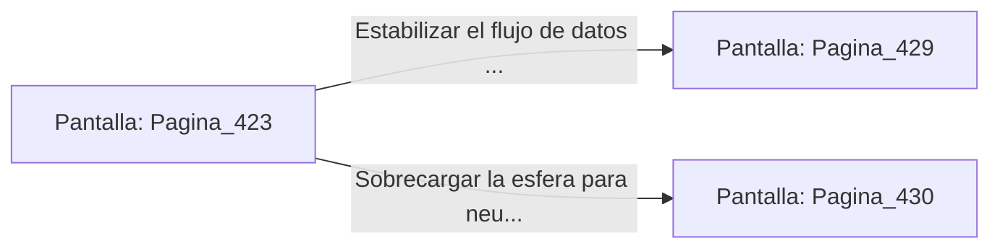

# 📺 Nodo Pantalla: `Pagina_423`

[[Index|⬅️ Índice]] | Fichero Origen: [[sample_eligejuego-code_capitulo_22_mpl|📄 sample/eligejuego-code/capitulo_22.mpl]]

**Narrativa y Encabezado:**
> PÁGINA 423: LA SALA DE DISTRIBUCIÓN MNEMÓNICA
> 
> Ingresas a la Sala de Distribución Mnemónica. Una inmensa esfera de cristal llena de suero violeta flota en el centro de la nave, distribuyendo energía de datos a los subsistemas de las Cámaras 424 a 450.
> 
> En la peana de la esfera reposa la Tarjeta de Nivel Cinco y un mando de purga que permite estabilizar el flujo o sobrecargar la esfera.
> 
> Sincronizas la Tarjeta de Nivel Cinco en tu Brazal de Convergencia antes de tomar una decisión respecto a la esfera.

## 📋 Desglose de Instrucciones de Opciones
### `OPCION "Estabilizar el flujo de datos mnemónicos en la consola" CON_ACCION TRANSICIONAR_A Pagina_429`
* **Instrucción:** `OPCION` *(Manual: Mapea una entrada o botón interactivo de usuario. Vincular una acción como la invocación de una función C1, un método C2 o una transición C3.)*
* **Efecto de Control:** Dispara `TRANSICIONAR_A` hacia [[Pantalla_Pagina_429|📺 Pagina_429]]
### `OPCION "Sobrecargar la esfera para neutralizar las torretas del sector" CON_ACCION TRANSICIONAR_A Pagina_430`
* **Instrucción:** `OPCION` *(Manual: Mapea una entrada o botón interactivo de usuario. Vincular una acción como la invocación de una función C1, un método C2 o una transición C3.)*
* **Efecto de Control:** Dispara `TRANSICIONAR_A` hacia [[Pantalla_Pagina_430|📺 Pagina_430]]

## 📊 Diagrama de Flujo e Interacción (Mermaid)

