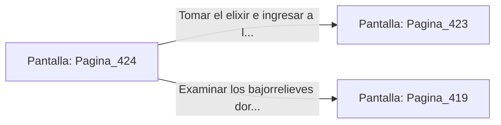

# 📺 Nodo Pantalla: `Pagina_424`

[[Index|⬅️ Índice]] | Fichero Origen: [[sample_eligejuego-code_capitulo_22_mpl|📄 sample/eligejuego-code/capitulo_22.mpl]]

**Narrativa y Encabezado:**
> PÁGINA 424: EL PASAJE DE LOS ARCHIVISTAS
> 
> Avanzas por el pasaje privado de los antiguos archivistas. Paredes de madera de rosa y cuadros con bajorrelieves dorados flanquean la bajada hacia la sala de distribución.
> 
> Al final del pasillo hallas una hornacina con un vial de elixir concentrado.

## 📋 Desglose de Instrucciones de Opciones
### `OPCION "Tomar el elixir e ingresar a la Sala de Distribución" CON_ACCION TRANSICIONAR_A Pagina_423`
* **Instrucción:** `OPCION` *(Manual: Mapea una entrada o botón interactivo de usuario. Vincular una acción como la invocación de una función C1, un método C2 o una transición C3.)*
* **Efecto de Control:** Dispara `TRANSICIONAR_A` hacia [[Pantalla_Pagina_423|📺 Pagina_423]]
### `OPCION "Examinar los bajorrelieves dorados" CON_ACCION TRANSICIONAR_A Pagina_419`
* **Instrucción:** `OPCION` *(Manual: Mapea una entrada o botón interactivo de usuario. Vincular una acción como la invocación de una función C1, un método C2 o una transición C3.)*
* **Efecto de Control:** Dispara `TRANSICIONAR_A` hacia [[Pantalla_Pagina_419|📺 Pagina_419]]

## 📊 Diagrama de Flujo e Interacción (Mermaid)

