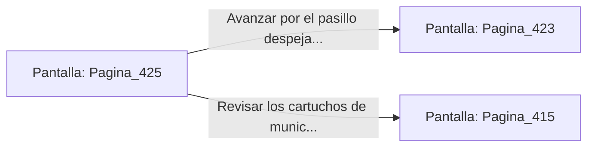

# 📺 Nodo Pantalla: `Pagina_425`

[[Index|⬅️ Índice]] | Fichero Origen: [[sample_eligejuego-code_capitulo_22_mpl|📄 sample/eligejuego-code/capitulo_22.mpl]]

**Narrativa y Encabezado:**
> PÁGINA 425: LA PROCESACIÓN DE LA CLAVE
> 
> Insertas la gema de cristal en la ranura de interfaz de tu Brazal. El procesador decodifica las secuencias de datos, registrando la clave de anulación que desactiva los cañones de inducción de los pasillos posteriores.
> 
> Con la clave activa en tu memoria, la pantalla del terminal muestra el mapa del sector, revelando una vía directa hacia los laboratorios del Capítulo 23.
> 
> Te encaminas a la salida del archivo con la certeza de haber neutralizado las defensas automáticas.

## 📋 Desglose de Instrucciones de Opciones
### `OPCION "Avanzar por el pasillo despejado hacia la Sala de Distribución" CON_ACCION TRANSICIONAR_A Pagina_423`
* **Instrucción:** `OPCION` *(Manual: Mapea una entrada o botón interactivo de usuario. Vincular una acción como la invocación de una función C1, un método C2 o una transición C3.)*
* **Efecto de Control:** Dispara `TRANSICIONAR_A` hacia [[Pantalla_Pagina_423|📺 Pagina_423]]
### `OPCION "Revisar los cartuchos de munición del archivo antes de salir" CON_ACCION TRANSICIONAR_A Pagina_415`
* **Instrucción:** `OPCION` *(Manual: Mapea una entrada o botón interactivo de usuario. Vincular una acción como la invocación de una función C1, un método C2 o una transición C3.)*
* **Efecto de Control:** Dispara `TRANSICIONAR_A` hacia [[Pantalla_Pagina_415|📺 Pagina_415]]

## 📊 Diagrama de Flujo e Interacción (Mermaid)

