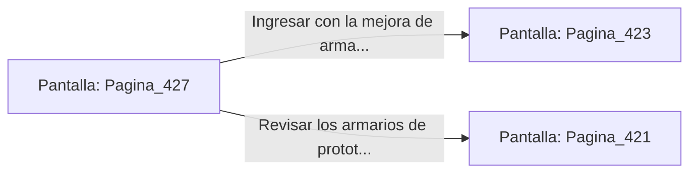

# 📺 Nodo Pantalla: `Pagina_427`

[[Index|⬅️ Índice]] | Fichero Origen: [[sample_eligejuego-code_capitulo_22_mpl|📄 sample/eligejuego-code/capitulo_22.mpl]]

**Narrativa y Encabezado:**
> PÁGINA 427: ANULACIÓN DEL AUTÓMATA DE PRUEBAS
> 
> Lanzas la bomba de pulso electromagnético directamente a los pies del autómata pesado. La onda expansiva desactiva de inmediato su escudo de inducción y sobrecarga los circuitos de su torso.
> 
> La unidad de combate se desploma inerte sobre el piso de la nave. Al examinar sus restos, recuperas un Cristal de Enfoque Térmico y dos células de energía de alto flujo.
> 
> Adosas el cristal a tu arma de fase antes de cruzar la puerta de salida hacia la Sala de Distribución.

## 📋 Desglose de Instrucciones de Opciones
### `OPCION "Ingresar con la mejora de arma a la Sala de Distribución" CON_ACCION TRANSICIONAR_A Pagina_423`
* **Instrucción:** `OPCION` *(Manual: Mapea una entrada o botón interactivo de usuario. Vincular una acción como la invocación de una función C1, un método C2 o una transición C3.)*
* **Efecto de Control:** Dispara `TRANSICIONAR_A` hacia [[Pantalla_Pagina_423|📺 Pagina_423]]
### `OPCION "Revisar los armarios de prototipos de la sala" CON_ACCION TRANSICIONAR_A Pagina_421`
* **Instrucción:** `OPCION` *(Manual: Mapea una entrada o botón interactivo de usuario. Vincular una acción como la invocación de una función C1, un método C2 o una transición C3.)*
* **Efecto de Control:** Dispara `TRANSICIONAR_A` hacia [[Pantalla_Pagina_421|📺 Pagina_421]]

## 📊 Diagrama de Flujo e Interacción (Mermaid)

