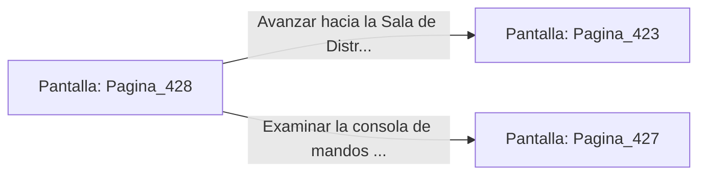

# 📺 Nodo Pantalla: `Pagina_428`

[[Index|⬅️ Índice]] | Fichero Origen: [[sample_eligejuego-code_capitulo_22_mpl|📄 sample/eligejuego-code/capitulo_22.mpl]]

**Narrativa y Encabezado:**
> PÁGINA 428: DISPAROS A LOS CONECTORES TRASEROS
> 
> Te esquivas bajo la embestida del autómata y descargas una ráfaga con tu Rifle Cronal contra los conectores de éter situados en su espalda. La máquina chispotea y pierde la energía de sus motores.
> 
> Con la amenaza neutralizada, te encaminas hacia la salida del sector de pruebas.

## 📋 Desglose de Instrucciones de Opciones
### `OPCION "Avanzar hacia la Sala de Distribución Mnemónica" CON_ACCION TRANSICIONAR_A Pagina_423`
* **Instrucción:** `OPCION` *(Manual: Mapea una entrada o botón interactivo de usuario. Vincular una acción como la invocación de una función C1, un método C2 o una transición C3.)*
* **Efecto de Control:** Dispara `TRANSICIONAR_A` hacia [[Pantalla_Pagina_423|📺 Pagina_423]]
### `OPCION "Examinar la consola de mandos del autómata" CON_ACCION TRANSICIONAR_A Pagina_427`
* **Instrucción:** `OPCION` *(Manual: Mapea una entrada o botón interactivo de usuario. Vincular una acción como la invocación de una función C1, un método C2 o una transición C3.)*
* **Efecto de Control:** Dispara `TRANSICIONAR_A` hacia [[Pantalla_Pagina_427|📺 Pagina_427]]

## 📊 Diagrama de Flujo e Interacción (Mermaid)

