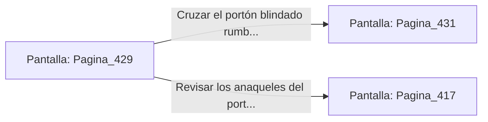

# 📺 Nodo Pantalla: `Pagina_429`

[[Index|⬅️ Índice]] | Fichero Origen: [[sample_eligejuego-code_capitulo_22_mpl|📄 sample/eligejuego-code/capitulo_22.mpl]]

**Narrativa y Encabezado:**
> PÁGINA 429: EL PASO HACIA EL CAPÍTULO 23
> 
> Con la Tarjeta de Nivel Cinco sincronizada y la esfera de datos estabilizada en parámetros seguros, el portón blindado de titanio del fondo de la nave se abre suavemente en dos mitades.
> 
> Ante ti se despliega la calzada iluminada por luz dorada que conduce a las Cámaras del Capítulo 23, donde se hallan las Bóvedas de la Alta Alquimia de Aethelgard.
> 
> Te detienes un instante a verificar la munición de tus armas y el estado médico de tu equipo antes de cruzar el umbral con determinación.

## 📋 Desglose de Instrucciones de Opciones
### `OPCION "Cruzar el portón blindado rumbo a las Cámaras del Capítulo 23" CON_ACCION TRANSICIONAR_A Pagina_431`
* **Instrucción:** `OPCION` *(Manual: Mapea una entrada o botón interactivo de usuario. Vincular una acción como la invocación de una función C1, un método C2 o una transición C3.)*
* **Efecto de Control:** Dispara `TRANSICIONAR_A` hacia [[Pantalla_Pagina_431|📺 Pagina_431]]
### `OPCION "Revisar los anaqueles del portón en busca de suministros" CON_ACCION TRANSICIONAR_A Pagina_417`
* **Instrucción:** `OPCION` *(Manual: Mapea una entrada o botón interactivo de usuario. Vincular una acción como la invocación de una función C1, un método C2 o una transición C3.)*
* **Efecto de Control:** Dispara `TRANSICIONAR_A` hacia [[Pantalla_Pagina_417|📺 Pagina_417]]

## 📊 Diagrama de Flujo e Interacción (Mermaid)

