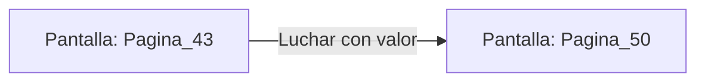

# 📺 Nodo Pantalla: `Pagina_43`

[[Index|⬅️ Índice]] | Fichero Origen: [[sample_eligejuego-code_capa3_vistas_3_mpl|📄 sample/eligejuego-code/capa3_vistas_3.mpl]]

**Encabezado Visual:** "Página 43: Salón de los Titanes Unos"

## 📋 Desglose de Instrucciones de Opciones
### `OPCION "Luchar con valor" CON_ACCION TRANSICIONAR_A Pagina_50`
* **Instrucción:** `OPCION` *(Manual: Mapea una entrada o botón interactivo de usuario. Vincular una acción como la invocación de una función C1, un método C2 o una transición C3.)*
* **Efecto de Control:** Dispara `TRANSICIONAR_A` hacia [[Pantalla_Pagina_50|📺 Pagina_50]] *(Manual: Primitiva de control de flujo UI. Emite un evento asíncrono al Event Loop para cambiar la vista activa a la pantalla de destino.)*

## 📊 Diagrama de Flujo e Interacción (Mermaid)

