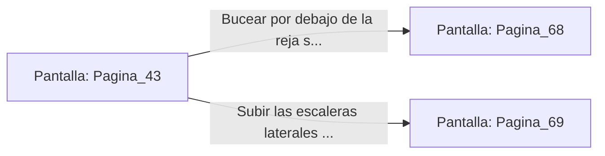

# 📺 Nodo Pantalla: `Pagina_43`

[[Index|⬅️ Índice]] | Fichero Origen: [[sample_eligejuego-code_capitulo_03_mpl|📄 sample/eligejuego-code/capitulo_03.mpl]]

**Narrativa y Encabezado:**
> PÁGINA 43: LAS CLOACAS PURIFICADORAS
> 
> Desciendes por la escala de servicio a los túneles inferiores de drenaje. A diferencia del foso de residuos, aquí fluye un agua clara saturada de sales alquímicas que purifican las toxinas de la ciudadela.
> 
> El eco de tus pisadas en la pasarela de hierro resuena a lo largo del canal. Al fondo, la corriente desemboca en una enorme reja sumergida que impide el paso, mientras que una escalera lateral sube hacia las cocinas del palacio.
> 
> Puedes intentar bucear por debajo de la reja sumergida o subir las escaleras hacia las cocinas.

## 📋 Desglose de Instrucciones de Opciones
### `OPCION "Bucear por debajo de la reja sumergida" CON_ACCION TRANSICIONAR_A Pagina_68`
* **Instrucción:** `OPCION` *(Manual: Mapea una entrada o botón interactivo de usuario. Vincular una acción como la invocación de una función C1, un método C2 o una transición C3.)*
* **Efecto de Control:** Dispara `TRANSICIONAR_A` hacia [[Pantalla_Pagina_68|📺 Pagina_68]]
### `OPCION "Subir las escaleras laterales hacia las cocinas del palacio" CON_ACCION TRANSICIONAR_A Pagina_69`
* **Instrucción:** `OPCION` *(Manual: Mapea una entrada o botón interactivo de usuario. Vincular una acción como la invocación de una función C1, un método C2 o una transición C3.)*
* **Efecto de Control:** Dispara `TRANSICIONAR_A` hacia [[Pantalla_Pagina_69|📺 Pagina_69]]

## 📊 Diagrama de Flujo e Interacción (Mermaid)

