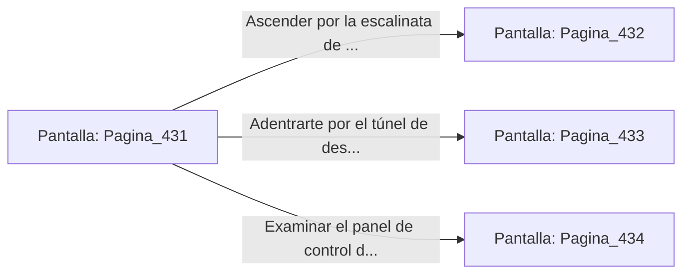

# 📺 Nodo Pantalla: `Pagina_431`

[[Index|⬅️ Índice]] | Fichero Origen: [[sample_eligejuego-code_capitulo_23_mpl|📄 sample/eligejuego-code/capitulo_23.mpl]]

**Narrativa y Encabezado:**
> PÁGINA 431: EL UMBRAL DE LA ALTA ALQUIMIA
> 
> Atraviesas el portón blindado e ingresas a la monumental nave de las Bóvedas de la Alta Alquimia. Enormes alambiques de cobre, matracas de cuarzo y autoclaves de bronce que hierven con soluciones bioluminiscentes cubren el espacio bajo una bóveda de piedra negra salpicada de runas purificadoras.
> 
> Tu Brazal de Convergencia indica que las Cámaras 431 a 450 albergan las reservas de reactivos primarios usados para estabilizar la energía del Núcleo de Éter. Guardianes Alquímicos formados por aleaciones flexibles y núcleos de azufre patrullan las pasarelas superiores con frascos de reactivo volátil.
> 
> Frente a ti se abren tres vías de avance: una escalinata de bronce que bordea los alambiques centrales, un túnel de destilación saturado por vapores de mercurio y un elevador de carga hidráulico.

## 📋 Desglose de Instrucciones de Opciones
### `OPCION "Ascender por la escalinata de bronce bordeando los alambiques" CON_ACCION TRANSICIONAR_A Pagina_432`
* **Instrucción:** `OPCION` *(Manual: Mapea una entrada o botón interactivo de usuario. Vincular una acción como la invocación de una función C1, un método C2 o una transición C3.)*
* **Efecto de Control:** Dispara `TRANSICIONAR_A` hacia [[Pantalla_Pagina_432|📺 Pagina_432]]
### `OPCION "Adentrarte por el túnel de destilación de vapores de mercurio" CON_ACCION TRANSICIONAR_A Pagina_433`
* **Instrucción:** `OPCION` *(Manual: Mapea una entrada o botón interactivo de usuario. Vincular una acción como la invocación de una función C1, un método C2 o una transición C3.)*
* **Efecto de Control:** Dispara `TRANSICIONAR_A` hacia [[Pantalla_Pagina_433|📺 Pagina_433]]
### `OPCION "Examinar el panel de control del elevador de carga hidráulico" CON_ACCION TRANSICIONAR_A Pagina_434`
* **Instrucción:** `OPCION` *(Manual: Mapea una entrada o botón interactivo de usuario. Vincular una acción como la invocación de una función C1, un método C2 o una transición C3.)*
* **Efecto de Control:** Dispara `TRANSICIONAR_A` hacia [[Pantalla_Pagina_434|📺 Pagina_434]]

## 📊 Diagrama de Flujo e Interacción (Mermaid)

