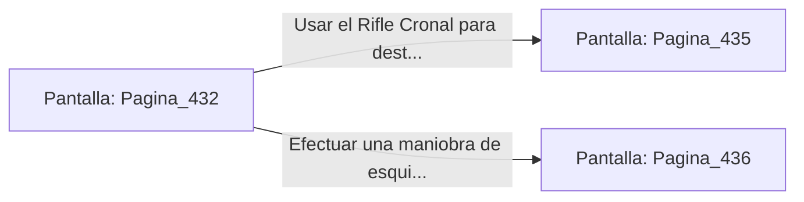

# 📺 Nodo Pantalla: `Pagina_432`

[[Index|⬅️ Índice]] | Fichero Origen: [[sample_eligejuego-code_capitulo_23_mpl|📄 sample/eligejuego-code/capitulo_23.mpl]]

**Narrativa y Encabezado:**
> PÁGINA 432: LA ESCALINATA DE BRONCE
> 
> Avanzas a paso firme por los peldaños de bronce mientras el calor emana de los recipientes en ebullición. El ambiente está saturado por un dulce aroma a aceites rúnicos y ozono que hace vibrar los sensores de tu visera.
> 
> A mitad de la subida, un Guardián Alquímico se interpone en tu camino alza un recipiente de fuego líquido dispuesto a derramarlo sobre la escalera.

## 📋 Desglose de Instrucciones de Opciones
### `OPCION "Usar el Rifle Cronal para destruir el recipiente de fuego líquido" CON_ACCION TRANSICIONAR_A Pagina_435`
* **Instrucción:** `OPCION` *(Manual: Mapea una entrada o botón interactivo de usuario. Vincular una acción como la invocación de una función C1, un método C2 o una transición C3.)*
* **Efecto de Control:** Dispara `TRANSICIONAR_A` hacia [[Pantalla_Pagina_435|📺 Pagina_435]]
### `OPCION "Efectuar una maniobra de esquiva para rodear al guardián" CON_ACCION TRANSICIONAR_A Pagina_436`
* **Instrucción:** `OPCION` *(Manual: Mapea una entrada o botón interactivo de usuario. Vincular una acción como la invocación de una función C1, un método C2 o una transición C3.)*
* **Efecto de Control:** Dispara `TRANSICIONAR_A` hacia [[Pantalla_Pagina_436|📺 Pagina_436]]

## 📊 Diagrama de Flujo e Interacción (Mermaid)

