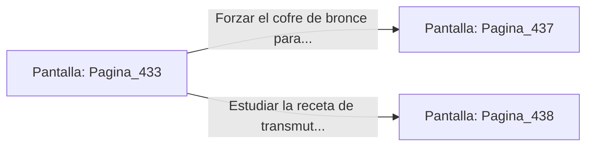

# 📺 Nodo Pantalla: `Pagina_433`

[[Index|⬅️ Índice]] | Fichero Origen: [[sample_eligejuego-code_capitulo_23_mpl|📄 sample/eligejuego-code/capitulo_23.mpl]]

**Narrativa y Encabezado:**
> PÁGINA 433: EL TÚNEL DE LOS VAPORES DE MERCURIO
> 
> Te adentras en el angosto túnel de destilación por el que circulan vapores plateados de mercurio arcano. La densidad del aire exige que los filtros de tu casco funcionen al máximo rendimiento para prevenir la corrosión de tu armadura.
> 
> Tras superar el tramo principal, alcanzas un taller de mezclas abandonado donde sobre un atril de teca descansa una receta de transmutación y un cofre de bronce sellado.
> 
> Tienes la opción de forzar el cofre de bronce para recuperar tónicos de salud o estudiar la receta de transmutación en el atril.

## 📋 Desglose de Instrucciones de Opciones
### `OPCION "Forzar el cofre de bronce para recuperar tónicos de salud" CON_ACCION TRANSICIONAR_A Pagina_437`
* **Instrucción:** `OPCION` *(Manual: Mapea una entrada o botón interactivo de usuario. Vincular una acción como la invocación de una función C1, un método C2 o una transición C3.)*
* **Efecto de Control:** Dispara `TRANSICIONAR_A` hacia [[Pantalla_Pagina_437|📺 Pagina_437]]
### `OPCION "Estudiar la receta de transmutación en el atril de teca" CON_ACCION TRANSICIONAR_A Pagina_438`
* **Instrucción:** `OPCION` *(Manual: Mapea una entrada o botón interactivo de usuario. Vincular una acción como la invocación de una función C1, un método C2 o una transición C3.)*
* **Efecto de Control:** Dispara `TRANSICIONAR_A` hacia [[Pantalla_Pagina_438|📺 Pagina_438]]

## 📊 Diagrama de Flujo e Interacción (Mermaid)

