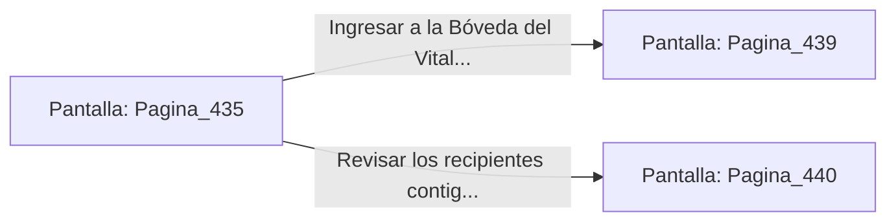

# 📺 Nodo Pantalla: `Pagina_435`

[[Index|⬅️ Índice]] | Fichero Origen: [[sample_eligejuego-code_capitulo_23_mpl|📄 sample/eligejuego-code/capitulo_23.mpl]]

**Narrativa y Encabezado:**
> PÁGINA 435: DESTRUCCIÓN EN LA ESCALINATA
> 
> Alineas la mira de tu Rifle Cronal y disparas una ráfaga precisa contra el frasco de fuego líquido en las manos del guardián. El recipiente estalla en una bola de fuego azulina que destruye al autómata e ilumina la bóveda con un resplandor cegador.
> 
> Con el peligro despejado, continúas el ascenso hasta la plataforma superior, donde hallas un nicho blindado con dos Células de Éter Sobrecargadas y una tarjeta de acceso a la Bóveda del Vitalismo.
> 
> Sincronizas las células con la fuente de energía de tu arma antes de dirigirte a la puerta de entrada de la Bóveda del Vitalismo.

## 📋 Desglose de Instrucciones de Opciones
### `OPCION "Ingresar a la Bóveda del Vitalismo con la tarjeta de acceso" CON_ACCION TRANSICIONAR_A Pagina_439`
* **Instrucción:** `OPCION` *(Manual: Mapea una entrada o botón interactivo de usuario. Vincular una acción como la invocación de una función C1, un método C2 o una transición C3.)*
* **Efecto de Control:** Dispara `TRANSICIONAR_A` hacia [[Pantalla_Pagina_439|📺 Pagina_439]]
### `OPCION "Revisar los recipientes contiguos en busca de más materiales" CON_ACCION TRANSICIONAR_A Pagina_440`
* **Instrucción:** `OPCION` *(Manual: Mapea una entrada o botón interactivo de usuario. Vincular una acción como la invocación de una función C1, un método C2 o una transición C3.)*
* **Efecto de Control:** Dispara `TRANSICIONAR_A` hacia [[Pantalla_Pagina_440|📺 Pagina_440]]

## 📊 Diagrama de Flujo e Interacción (Mermaid)

