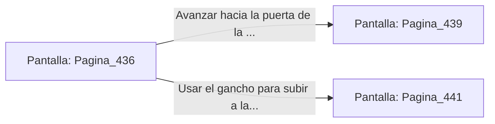

# 📺 Nodo Pantalla: `Pagina_436`

[[Index|⬅️ Índice]] | Fichero Origen: [[sample_eligejuego-code_capitulo_23_mpl|📄 sample/eligejuego-code/capitulo_23.mpl]]

**Narrativa y Encabezado:**
> PÁGINA 436: ESQUIVA EN LA ESCALINATA
> 
> Te te lanzas lateralmente rodando por los peldaños en el instante en que el guardián derrama el fuego líquido. Las llamas de plasma abrasan la barandilla de bronce sin tocar tu armadura.
> 
> Te reincorporas velozmente tras la estatua de un antiguo alquimista y avanzas hacia el descansillo superior.

## 📋 Desglose de Instrucciones de Opciones
### `OPCION "Avanzar hacia la puerta de la Bóveda del Vitalismo" CON_ACCION TRANSICIONAR_A Pagina_439`
* **Instrucción:** `OPCION` *(Manual: Mapea una entrada o botón interactivo de usuario. Vincular una acción como la invocación de una función C1, un método C2 o una transición C3.)*
* **Efecto de Control:** Dispara `TRANSICIONAR_A` hacia [[Pantalla_Pagina_439|📺 Pagina_439]]
### `OPCION "Usar el gancho para subir a la pasarela de control" CON_ACCION TRANSICIONAR_A Pagina_441`
* **Instrucción:** `OPCION` *(Manual: Mapea una entrada o botón interactivo de usuario. Vincular una acción como la invocación de una función C1, un método C2 o una transición C3.)*
* **Efecto de Control:** Dispara `TRANSICIONAR_A` hacia [[Pantalla_Pagina_441|📺 Pagina_441]]

## 📊 Diagrama de Flujo e Interacción (Mermaid)

