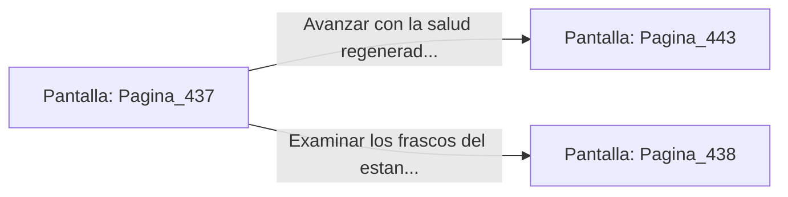

# 📺 Nodo Pantalla: `Pagina_437`

[[Index|⬅️ Índice]] | Fichero Origen: [[sample_eligejuego-code_capitulo_23_mpl|📄 sample/eligejuego-code/capitulo_23.mpl]]

**Narrativa y Encabezado:**
> PÁGINA 437: EL COFRE DE LOS TÓNICOS ALQUÍMICOS
> 
> Fuerzas la cerradura del cofre de bronce usando la estaca rúnica de tu Brazal. La tapa se abre revelando dos viales de Elixir de Purificación y una bomba de humo térmico concentrado.
> 
> Inyectas el contenido de uno de los elixires en tu armadura, sintiendo cómo una ola de calor regenerativo sana las contusiones y restaura por completo la salud de tu equipo.
> 
> Guardas el segundo vial en tu arnés y avanzas por la salida del taller hacia la Cámara de las Esencias.

## 📋 Desglose de Instrucciones de Opciones
### `OPCION "Avanzar con la salud regenerada hacia la Cámara de las Esencias" CON_ACCION TRANSICIONAR_A Pagina_443`
* **Instrucción:** `OPCION` *(Manual: Mapea una entrada o botón interactivo de usuario. Vincular una acción como la invocación de una función C1, un método C2 o una transición C3.)*
* **Efecto de Control:** Dispara `TRANSICIONAR_A` hacia [[Pantalla_Pagina_443|📺 Pagina_443]]
### `OPCION "Examinar los frascos del estante contiguo antes de salir" CON_ACCION TRANSICIONAR_A Pagina_438`
* **Instrucción:** `OPCION` *(Manual: Mapea una entrada o botón interactivo de usuario. Vincular una acción como la invocación de una función C1, un método C2 o una transición C3.)*
* **Efecto de Control:** Dispara `TRANSICIONAR_A` hacia [[Pantalla_Pagina_438|📺 Pagina_438]]

## 📊 Diagrama de Flujo e Interacción (Mermaid)

