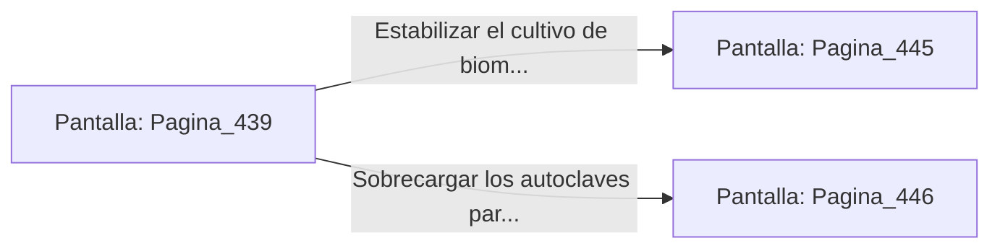

# 📺 Nodo Pantalla: `Pagina_439`

[[Index|⬅️ Índice]] | Fichero Origen: [[sample_eligejuego-code_capitulo_23_mpl|📄 sample/eligejuego-code/capitulo_23.mpl]]

**Narrativa y Encabezado:**
> PÁGINA 439: LA BÓVEDA DEL VITALISMO
> 
> Deslizas la tarjeta de acceso por la ranura rúnica e ingresas a la vasta Bóveda del Vitalismo. Cúpulas de cristal contienen cultivos de biomasa vegetal sintética suspendidos en suero de éter, destilando reactivos medicinales de alta pureza.
> 
> En la consola principal brilla una Tarjeta de Nivel Seis y un conmutador de purga que permite estabilizar la biomasa o sobrecargar los autoclaves.
> 
> Sincronizas la Tarjeta de Nivel Seis en tu Brazal de Convergencia antes de decidir la acción sobre la consola.

## 📋 Desglose de Instrucciones de Opciones
### `OPCION "Estabilizar el cultivo de biomasa en la consola central" CON_ACCION TRANSICIONAR_A Pagina_445`
* **Instrucción:** `OPCION` *(Manual: Mapea una entrada o botón interactivo de usuario. Vincular una acción como la invocación de una función C1, un método C2 o una transición C3.)*
* **Efecto de Control:** Dispara `TRANSICIONAR_A` hacia [[Pantalla_Pagina_445|📺 Pagina_445]]
### `OPCION "Sobrecargar los autoclaves para limpiar los pasillos de guardias" CON_ACCION TRANSICIONAR_A Pagina_446`
* **Instrucción:** `OPCION` *(Manual: Mapea una entrada o botón interactivo de usuario. Vincular una acción como la invocación de una función C1, un método C2 o una transición C3.)*
* **Efecto de Control:** Dispara `TRANSICIONAR_A` hacia [[Pantalla_Pagina_446|📺 Pagina_446]]

## 📊 Diagrama de Flujo e Interacción (Mermaid)

