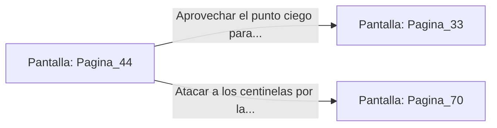

# 📺 Nodo Pantalla: `Pagina_44`

[[Index|⬅️ Índice]] | Fichero Origen: [[sample_eligejuego-code_capitulo_03_mpl|📄 sample/eligejuego-code/capitulo_03.mpl]]

**Narrativa y Encabezado:**
> PÁGINA 44: RUMBO AL GRAN ARCHIVO
> 
> Siguiendo las coordenadas obtenidas en la descarga, avanzas a paso ligero por los pasillos decorados con estandartes de Malakor hasta la entrada norte del Gran Archivo.
> 
> Dos centinelas mecánicos vigilan la puerta, pero sus patrones de escaneo tienen un punto ciego de cuatro segundos.

## 📋 Desglose de Instrucciones de Opciones
### `OPCION "Aprovechar el punto ciego para colarte en el Gran Archivo" CON_ACCION TRANSICIONAR_A Pagina_33`
* **Instrucción:** `OPCION` *(Manual: Mapea una entrada o botón interactivo de usuario. Vincular una acción como la invocación de una función C1, un método C2 o una transición C3.)*
* **Efecto de Control:** Dispara `TRANSICIONAR_A` hacia [[Pantalla_Pagina_33|📺 Pagina_33]]
### `OPCION "Atacar a los centinelas por la espalda antes de entrar" CON_ACCION TRANSICIONAR_A Pagina_70`
* **Instrucción:** `OPCION` *(Manual: Mapea una entrada o botón interactivo de usuario. Vincular una acción como la invocación de una función C1, un método C2 o una transición C3.)*
* **Efecto de Control:** Dispara `TRANSICIONAR_A` hacia [[Pantalla_Pagina_70|📺 Pagina_70]]

## 📊 Diagrama de Flujo e Interacción (Mermaid)

