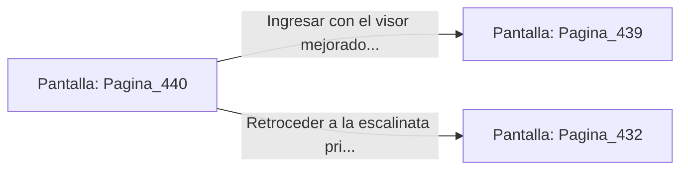

# 📺 Nodo Pantalla: `Pagina_440`

[[Index|⬅️ Índice]] | Fichero Origen: [[sample_eligejuego-code_capitulo_23_mpl|📄 sample/eligejuego-code/capitulo_23.mpl]]

**Narrativa y Encabezado:**
> PÁGINA 440: REVISIÓN DE CONTENEDORES
> 
> Examinas los recipientes contiguos al nicho blindado y descubres un cristal de enfoque óptico que adosas al visor de tu casco.
> 
> Con la mejora integrada, ingresas con la tarjeta a la Bóveda del Vitalismo.

## 📋 Desglose de Instrucciones de Opciones
### `OPCION "Ingresar con el visor mejorado a la Bóveda del Vitalismo" CON_ACCION TRANSICIONAR_A Pagina_439`
* **Instrucción:** `OPCION` *(Manual: Mapea una entrada o botón interactivo de usuario. Vincular una acción como la invocación de una función C1, un método C2 o una transición C3.)*
* **Efecto de Control:** Dispara `TRANSICIONAR_A` hacia [[Pantalla_Pagina_439|📺 Pagina_439]]
### `OPCION "Retroceder a la escalinata principal" CON_ACCION TRANSICIONAR_A Pagina_432`
* **Instrucción:** `OPCION` *(Manual: Mapea una entrada o botón interactivo de usuario. Vincular una acción como la invocación de una función C1, un método C2 o una transición C3.)*
* **Efecto de Control:** Dispara `TRANSICIONAR_A` hacia [[Pantalla_Pagina_432|📺 Pagina_432]]

## 📊 Diagrama de Flujo e Interacción (Mermaid)

