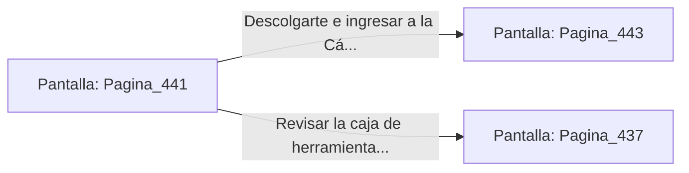

# 📺 Nodo Pantalla: `Pagina_441`

[[Index|⬅️ Índice]] | Fichero Origen: [[sample_eligejuego-code_capitulo_23_mpl|📄 sample/eligejuego-code/capitulo_23.mpl]]

**Narrativa y Encabezado:**
> PÁGINA 441: LA PASARELA DE CONTROL ALQUÍMICO
> 
> Te encaramas a la pasarela de control colgada sobre los alambiques. Desde esta posición elevada divisas las patrullas de guardianes de azufre desplazándose por los pasillos inferiores sin detectar tu presencia.
> 
> En el extremo de la pasarela hallas una consola de mantenimiento que permite descargar los códigos de acceso a la Cámara de las Esencias.
> 
> Descargas los códigos en tu Brazal y te descolgaste hacia la puerta de la Cámara de las Esencias.

## 📋 Desglose de Instrucciones de Opciones
### `OPCION "Descolgarte e ingresar a la Cámara de las Esencias" CON_ACCION TRANSICIONAR_A Pagina_443`
* **Instrucción:** `OPCION` *(Manual: Mapea una entrada o botón interactivo de usuario. Vincular una acción como la invocación de una función C1, un método C2 o una transición C3.)*
* **Efecto de Control:** Dispara `TRANSICIONAR_A` hacia [[Pantalla_Pagina_443|📺 Pagina_443]]
### `OPCION "Revisar la caja de herramientas de la pasarela" CON_ACCION TRANSICIONAR_A Pagina_437`
* **Instrucción:** `OPCION` *(Manual: Mapea una entrada o botón interactivo de usuario. Vincular una acción como la invocación de una función C1, un método C2 o una transición C3.)*
* **Efecto de Control:** Dispara `TRANSICIONAR_A` hacia [[Pantalla_Pagina_437|📺 Pagina_437]]

## 📊 Diagrama de Flujo e Interacción (Mermaid)

