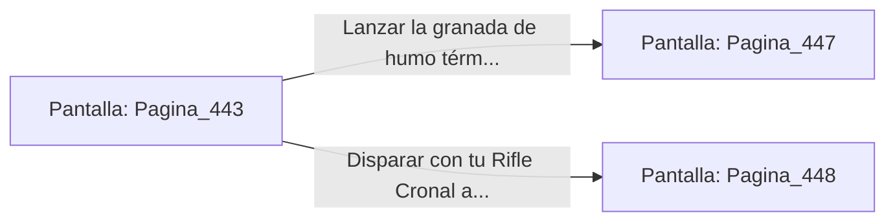

# 📺 Nodo Pantalla: `Pagina_443`

[[Index|⬅️ Índice]] | Fichero Origen: [[sample_eligejuego-code_capitulo_23_mpl|📄 sample/eligejuego-code/capitulo_23.mpl]]

**Narrativa y Encabezado:**
> PÁGINA 443: LA CÁMARA DE LAS ESENCIAS
> 
> Penetras en la Cámara de las Esencias carrying tus armas a punto. Grandes esferas de cuarzo llenas de fluidos de diferentes colores giran en soportes magnéticos, filtrando la energía que se alimenta a los laboratorios superiores.
> 
> Un autómata pesado de alquimia custodia el pedestal central donde reposa un frasco de Éter Puro Concentrado. La unidad activa su maza de plasma e inicia el ataque.
> 
> Puedes usar una granada de humo térmico para cegar sus sensores o disparar a la junta de su núcleo de azufre con tu Rifle Cronal.

## 📋 Desglose de Instrucciones de Opciones
### `OPCION "Lanzar la granada de humo térmico para ciegar al autómata" CON_ACCION TRANSICIONAR_A Pagina_447`
* **Instrucción:** `OPCION` *(Manual: Mapea una entrada o botón interactivo de usuario. Vincular una acción como la invocación de una función C1, un método C2 o una transición C3.)*
* **Efecto de Control:** Dispara `TRANSICIONAR_A` hacia [[Pantalla_Pagina_447|📺 Pagina_447]]
### `OPCION "Disparar con tu Rifle Cronal a la junta de su núcleo de azufre" CON_ACCION TRANSICIONAR_A Pagina_448`
* **Instrucción:** `OPCION` *(Manual: Mapea una entrada o botón interactivo de usuario. Vincular una acción como la invocación de una función C1, un método C2 o una transición C3.)*
* **Efecto de Control:** Dispara `TRANSICIONAR_A` hacia [[Pantalla_Pagina_448|📺 Pagina_448]]

## 📊 Diagrama de Flujo e Interacción (Mermaid)

