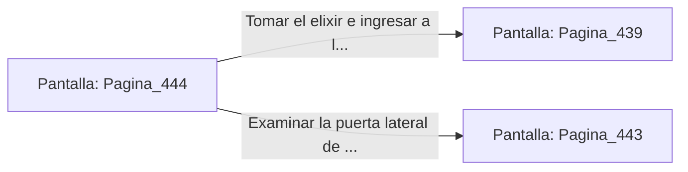

# 📺 Nodo Pantalla: `Pagina_444`

[[Index|⬅️ Índice]] | Fichero Origen: [[sample_eligejuego-code_capitulo_23_mpl|📄 sample/eligejuego-code/capitulo_23.mpl]]

**Narrativa y Encabezado:**
> PÁGINA 444: EL PASADIZO DE LOS DESTILADORES
> 
> Avanzas por el pasadizo privado de los maestros destiladores. Las paredes revestidas de azulejos blancos reflejan la luz de los tubos bioluminiscentes.
> 
> Al final de la galería encuentras una hornacina con un frasco de elixir reconstituyente.

## 📋 Desglose de Instrucciones de Opciones
### `OPCION "Tomar el elixir e ingresar a la Bóveda del Vitalismo" CON_ACCION TRANSICIONAR_A Pagina_439`
* **Instrucción:** `OPCION` *(Manual: Mapea una entrada o botón interactivo de usuario. Vincular una acción como la invocación de una función C1, un método C2 o una transición C3.)*
* **Efecto de Control:** Dispara `TRANSICIONAR_A` hacia [[Pantalla_Pagina_439|📺 Pagina_439]]
### `OPCION "Examinar la puerta lateral de la galería" CON_ACCION TRANSICIONAR_A Pagina_443`
* **Instrucción:** `OPCION` *(Manual: Mapea una entrada o botón interactivo de usuario. Vincular una acción como la invocación de una función C1, un método C2 o una transición C3.)*
* **Efecto de Control:** Dispara `TRANSICIONAR_A` hacia [[Pantalla_Pagina_443|📺 Pagina_443]]

## 📊 Diagrama de Flujo e Interacción (Mermaid)

