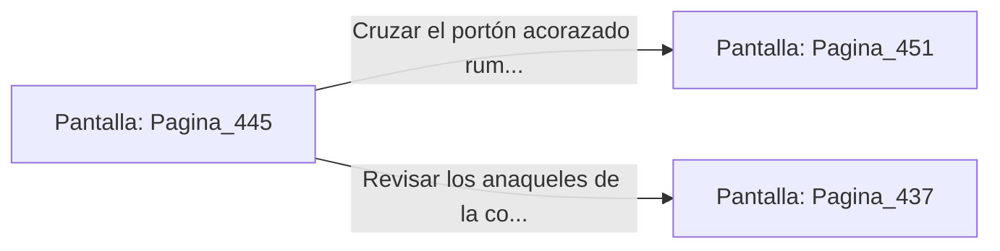

# 📺 Nodo Pantalla: `Pagina_445`

[[Index|⬅️ Índice]] | Fichero Origen: [[sample_eligejuego-code_capitulo_23_mpl|📄 sample/eligejuego-code/capitulo_23.mpl]]

**Narrativa y Encabezado:**
> PÁGINA 445: LA PURGA Y EL PASO AL CAPÍTULO 24
> 
> Con la Tarjeta de Nivel Seis autenticada, ejecutas la orden de estabilización en la consola. El flujo de biomasa sintética se equilibra en parámetros óptimos y los cierres acorazados de la puerta norte se retiran lentamente.
> 
> Ante ti se despliega la amplia calzada iluminada por cristales dorados que conduce hacia las Cámaras del Capítulo 24, donde aguardan los Talleres de Forja de Titanio.
> 
> Verificas el estado de tus armas y tu reserva médica antes de cruzar el umbral del Capítulo 24.

## 📋 Desglose de Instrucciones de Opciones
### `OPCION "Cruzar el portón acorazado rumbo al Capítulo 24" CON_ACCION TRANSICIONAR_A Pagina_451`
* **Instrucción:** `OPCION` *(Manual: Mapea una entrada o botón interactivo de usuario. Vincular una acción como la invocación de una función C1, un método C2 o una transición C3.)*
* **Efecto de Control:** Dispara `TRANSICIONAR_A` hacia [[Pantalla_Pagina_451|📺 Pagina_451]]
### `OPCION "Revisar los anaqueles de la consola en busca de suministros" CON_ACCION TRANSICIONAR_A Pagina_437`
* **Instrucción:** `OPCION` *(Manual: Mapea una entrada o botón interactivo de usuario. Vincular una acción como la invocación de una función C1, un método C2 o una transición C3.)*
* **Efecto de Control:** Dispara `TRANSICIONAR_A` hacia [[Pantalla_Pagina_437|📺 Pagina_437]]

## 📊 Diagrama de Flujo e Interacción (Mermaid)

