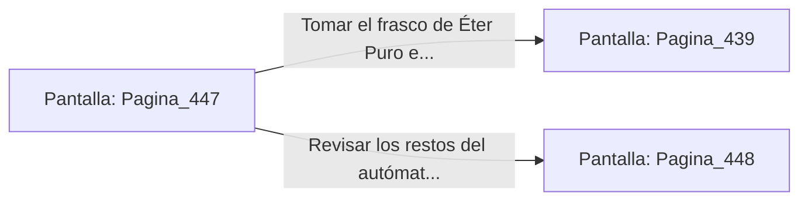

# 📺 Nodo Pantalla: `Pagina_447`

[[Index|⬅️ Índice]] | Fichero Origen: [[sample_eligejuego-code_capitulo_23_mpl|📄 sample/eligejuego-code/capitulo_23.mpl]]

**Narrativa y Encabezado:**
> PÁGINA 447: NEUTRALIZACIÓN DEL GUARDIÁN DE ALQUIMIA
> 
> Lanzas la granada de humo térmico a los pies del autómata pesado. La niebla opaca ciega sus visores ópticos y hace que descargue su maza de plasma a ciegas contra una columna de cuarzo.
> 
> Aprovechas la confusión para rodear a la máquina y asestar una estocada con tu arma en el núcleo de azufre de su espalda, desactivándolo al instante.
> 
> Te apoderas del frasco de Éter Puro Concentrado del pedestal antes de avanzar a la Bóveda del Vitalismo.

## 📋 Desglose de Instrucciones de Opciones
### `OPCION "Tomar el frasco de Éter Puro e ingresar a la Bóveda del Vitalismo" CON_ACCION TRANSICIONAR_A Pagina_439`
* **Instrucción:** `OPCION` *(Manual: Mapea una entrada o botón interactivo de usuario. Vincular una acción como la invocación de una función C1, un método C2 o una transición C3.)*
* **Efecto de Control:** Dispara `TRANSICIONAR_A` hacia [[Pantalla_Pagina_439|📺 Pagina_439]]
### `OPCION "Revisar los restos del autómata destruido" CON_ACCION TRANSICIONAR_A Pagina_448`
* **Instrucción:** `OPCION` *(Manual: Mapea una entrada o botón interactivo de usuario. Vincular una acción como la invocación de una función C1, un método C2 o una transición C3.)*
* **Efecto de Control:** Dispara `TRANSICIONAR_A` hacia [[Pantalla_Pagina_448|📺 Pagina_448]]

## 📊 Diagrama de Flujo e Interacción (Mermaid)

