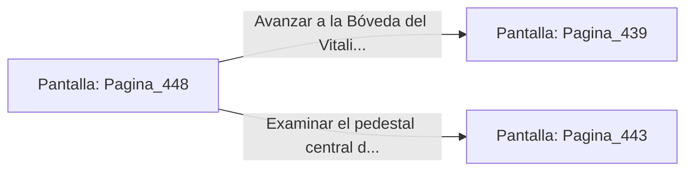

# 📺 Nodo Pantalla: `Pagina_448`

[[Index|⬅️ Índice]] | Fichero Origen: [[sample_eligejuego-code_capitulo_23_mpl|📄 sample/eligejuego-code/capitulo_23.mpl]]

**Narrativa y Encabezado:**
> PÁGINA 448: IMPACTO EN EL NÚCLEO DE AZUFRE
> 
> Descargas una ráfaga con el Rifle Cronal directamente en la junta del núcleo de azufre. La explosión destruye el distribuidor de energía del autómata, haciéndolo desplomarse sobre las losas.
> 
> Con la nave despejada, recoges las células de energía de los restos y te encaminas a la salida.

## 📋 Desglose de Instrucciones de Opciones
### `OPCION "Avanzar a la Bóveda del Vitalismo con las células recuperadas" CON_ACCION TRANSICIONAR_A Pagina_439`
* **Instrucción:** `OPCION` *(Manual: Mapea una entrada o botón interactivo de usuario. Vincular una acción como la invocación de una función C1, un método C2 o una transición C3.)*
* **Efecto de Control:** Dispara `TRANSICIONAR_A` hacia [[Pantalla_Pagina_439|📺 Pagina_439]]
### `OPCION "Examinar el pedestal central de las esferas" CON_ACCION TRANSICIONAR_A Pagina_443`
* **Instrucción:** `OPCION` *(Manual: Mapea una entrada o botón interactivo de usuario. Vincular una acción como la invocación de una función C1, un método C2 o una transición C3.)*
* **Efecto de Control:** Dispara `TRANSICIONAR_A` hacia [[Pantalla_Pagina_443|📺 Pagina_443]]

## 📊 Diagrama de Flujo e Interacción (Mermaid)

