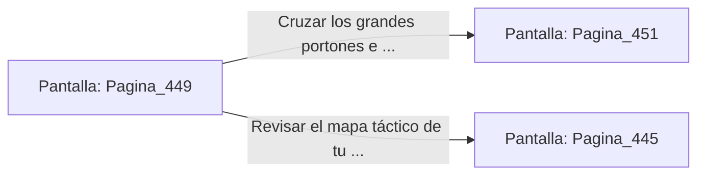

# 📺 Nodo Pantalla: `Pagina_449`

[[Index|⬅️ Índice]] | Fichero Origen: [[sample_eligejuego-code_capitulo_23_mpl|📄 sample/eligejuego-code/capitulo_23.mpl]]

**Narrativa y Encabezado:**
> PÁGINA 449: EL CAMINO DE LA ALTA ALQUIMIA CUMPLIDO
> 
> Atraviesas las galerías purificadas de las Bóvedas de la Alta Alquimia llevando la Tarjeta de Nivel Seis y tus reservas curativas al máximo. Las luces de los alambiques brillan con un tono dorado pacífico.
> 
> Tu Brazal de Convergencia registra que las Cámaras 431 a 450 han sido estabilizadas con éxito en la red mnemónica de la ciudadela.
> 
> Llegas frente a los grandes portones del Capítulo 24 con la certeza del deber cumplido.

## 📋 Desglose de Instrucciones de Opciones
### `OPCION "Cruzar los grandes portones e ingresar al Capítulo 24" CON_ACCION TRANSICIONAR_A Pagina_451`
* **Instrucción:** `OPCION` *(Manual: Mapea una entrada o botón interactivo de usuario. Vincular una acción como la invocación de una función C1, un método C2 o una transición C3.)*
* **Efecto de Control:** Dispara `TRANSICIONAR_A` hacia [[Pantalla_Pagina_451|📺 Pagina_451]]
### `OPCION "Revisar el mapa táctico de tu Brazal antes de avanzar" CON_ACCION TRANSICIONAR_A Pagina_445`
* **Instrucción:** `OPCION` *(Manual: Mapea una entrada o botón interactivo de usuario. Vincular una acción como la invocación de una función C1, un método C2 o una transición C3.)*
* **Efecto de Control:** Dispara `TRANSICIONAR_A` hacia [[Pantalla_Pagina_445|📺 Pagina_445]]

## 📊 Diagrama de Flujo e Interacción (Mermaid)

